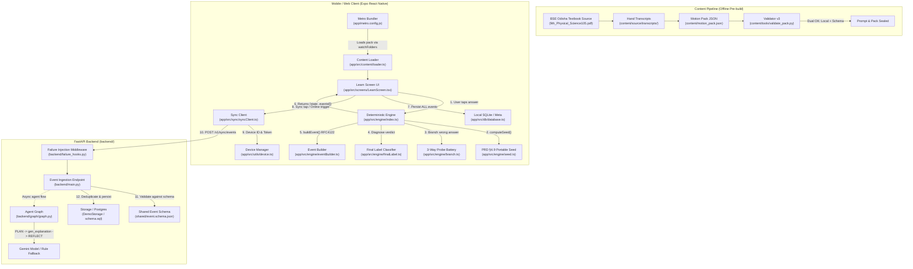

# FLOW.md — System Execution & Traceability Map
> *"Bugs live in the gaps between files. If you can't see the flow, you can't see where it breaks — and neither can the AI."*

This document maps how execution actually travels through **Padhai Pocket** across files, functions, modules, state boundaries, and network hops. Every engineer and AI agent modifying this repository must consult and update this trace before and after changing any interface.

---

## 1. High-Level System Architecture Flow



---

## 2. End-to-End Execution Lifecycles

### Path A: App Boot & Content Hydration
Execution flow when a learner opens the app:

```text
[Boot] app/App.tsx
  │
  ├──> [Navigation Container]
  │      └──> Routes to [LearnScreen.tsx]
  │
  ├──> [LearnScreen.tsx: useEffect (Mount)]
  │      ├──> getDeviceId() [app/src/utils/device.ts | device.web.ts]
  │      │      ├──> Queries SQLite 'device_meta' for key 'device_id'
  │      │      └──> If missing: generates 'dev-' + uuidv4() (RFC 4122) and stores in SQLite/localStorage
  │      │
  │      ├──> initDb() [app/src/db/database.ts]
  │      │      ├──> Executes CREATE TABLE IF NOT EXISTS events (event_id PRIMARY KEY, ...)
  │      │      └──> Executes CREATE TABLE IF NOT EXISTS device_meta (key PRIMARY KEY, value)
  │      │
  │      ├──> detectNetworkMode(HEALTH_URL) [app/src/network/network.ts]
  │      │      └──> Pings GET /healthz with timeout -> sets state ('ONLINE' | 'DEGRADED' | 'OFFLINE')
  │      │
  │      └──> refreshPending() [app/src/db/database.ts]
  │             └──> SELECT COUNT(*) FROM events WHERE sync_state = 'PENDING' -> sets badge count
  │
  └──> [Content Hydration via loader.ts]
         ├──> import pack from '../../../content/motion_pack.json' (via Metro watchFolders)
         ├──> getHeroChunk() -> returns chunk 'BSE9-PHYS-MOTION-S02-02' (Odia text & section title)
         ├──> getHeroItem()  -> returns item 'DVD-A-T' (stem, options, correct index, misconception tag)
         └──> getPackHash()  -> returns manifest sha256 prefix for UI authenticity badge
```

---

### Path B: The Diagnostic Learning & Misconception Flow (Core Engine Loop)
Execution flow when a learner answers a question:

```text
[Learner Taps Option Button]
  │
  └──> LearnScreen.tsx :: handleAnswer(selectedIndex: number)
         │
         ├──> 1. Form Context Object:
         │      now = Date.now()
         │      seed = computeSeed(PROFILE_ID, CONCEPT_ID, SET_ID) [app/src/engine/seed.ts]
         │             └─> sha256(profile|concept|set) -> byte arithmetic uint32
         │      device_id = deviceId (from getDeviceId())
         │      ctx = { now, seed, device_id }
         │
         ├──> 2. Dispatch to State Machine:
         │      engineResult = nextAction(engineStateRef.current, {
         │        type: 'OBSERVE_MCQ',
         │        correct: isCorrect,
         │        misconception_tag: isCorrect ? null : question.misconception
         │      }, ctx) [app/src/engine/index.ts]
         │
         ├──> 3. State Machine Internal Transitions [app/src/engine/index.ts]:
         │      │
         │      ├── [If Answer is WRONG]:
         │      │     └──> handleOfflineWrongAnswer() [app/src/engine/branch.ts]
         │      │            ├──> probeOrder(seed) computes permutation of ['P', 'A', 'T']
         │      │            ├──> Emits PLAN event: { action: "SCHEDULE_PROBE_BATTERY", order: [...] }
         │      │            ├──> Schedules Probe 1 (e.g. 'DVD-A-P')
         │      │            └──> Sets state to PROBING_1
         │      │
         │      ├── [During 3-Way Probe Responses]:
         │      │     └──> Collects P, A, T responses
         │      │            └──> Calls finalLabel(state, probeResponses) [app/src/engine/finalLabel.ts]
         │      │                   ├──> Evaluates consistency vector against probe_vectors.json
         │      │                   ├──> Labels: 'CONFIRMED_MISCONCEPTION' | 'PARTIAL' | 'SLIP' | 'GUESS'
         │      │                   └──> Emits DIAGNOSIS event
         │      │
         │      ├── [Post-Diagnosis]:
         │      │     ├──> Emits REMEDIATE event (points to Chunk 'BSE9-PHYS-MOTION-S02-02')
         │      │     ├──> Dispatches confirmation item ('W1' / 'W2' / 'TX' / 'PX' / 'PM1')
         │      │     └──> Updates BKT mastery probability
         │      │
         │      └── [At every transition step]:
         │            └──> buildEvent(...) [app/src/engine/eventBuilder.ts]
         │                   ├──> Injects uuidv4() for event_id
         │                   ├──> Injects ctx.device_id
         │                   ├──> Injects strict timestamps and sequence numbers
         │                   └──> Validates against shared/event.schema.json
         │
         ├──> 4. State & Event Return:
         │      returns { state: StepState, events: EventNode[] }
         │
         ├──> 5. Event Batch Persistence [LearnScreen.tsx: lines 181-184]:
         │      for (const event of engineResult.events) {
         │        await insertEvent(event as any) [app/src/db/database.ts]
         │          └──> INSERT INTO events VALUES (..., sync_state = 'PENDING', error_count = 0)
         │      }
         │
         └──> 6. UI Re-render:
                ├──> Increments seq counter
                ├──> Renders feedback / probe / remediation card
                └──> Updates pending sync badge
```

---

### Path C: Offline-First Synchronization Flow
Execution flow when events sync to the cloud:

```text
[Sync Trigger: User Button OR Network Mode Transition to 'ONLINE']
  │
  └──> LearnScreen.tsx :: sync()
         │
         ├──> syncPending({ baseUrl, deviceId, token }) [app/src/sync/syncClient.ts]
         │      │
         │      ├──> 1. detectNetworkMode(healthUrl)
         │      │      └──> Aborts with { synced: 0, skipped: true } if not ONLINE
         │      │
         │      ├──> 2. pendingEvents(limit = 50) [app/src/db/database.ts]
         │      │      └──> SELECT payload FROM events WHERE sync_state = 'PENDING' ORDER BY seq ASC
         │      │
         │      ├──> 3. getDeviceToken(baseUrl, deviceId) [app/src/sync/syncClient.ts]
         │      │      ├──> Reads from SecureStore.getItemAsync('device_token')
         │      │      └──> If absent: calls POST /v1/devices/register or uses dev token fallback
         │      │
         │      ├──> 4. POST /v1/sync/events [FastAPI Backend]
         │      │      Headers: { Authorization: "Bearer <token>", Content-Type: "application/json" }
         │      │      Body:    { device_id: "dev-...", events: [ ... ] }
         │      │
         │      ├─── [NETWORK HOP: CLIENT -> BACKEND] ───
         │      │
         │      ├──> [backend/failure_hooks.py :: FailureInjectionMiddleware]
         │      │      └──> Checks for simulated chaos headers (e.g. latency, error codes)
         │      │
         │      ├──> [backend/main.py :: sync_events()]
         │      │      ├──> verify_device_token(authorization) -> authenticates device
         │      │      ├──> For each event:
         │      │      │      ├──> jsonschema.validate(event, EVENT_SCHEMA)
         │      │      │      │      └──> Schema fail: returns 422 Unprocessable Entity
         │      │      │      ├──> Deduplication check on (profile_id, seq) and event_id
         │      │      │      └──> demo_storage.events[event_id] = event
         │      │      └──> Returns 200 OK: { acked_ids: [ "evt-uuid-1", "evt-uuid-2", ... ] }
         │      │
         │      ├─── [NETWORK HOP: BACKEND -> CLIENT] ───
         │      │
         │      └──> 5. Acknowledgment Handling [app/src/sync/syncClient.ts]:
         │             ├──> On 200 OK:
         │             │      markAcked(data.acked_ids) [app/src/db/database.ts]
         │             │        └──> UPDATE events SET sync_state = 'ACKED' WHERE event_id IN (...)
         │             └──> On Network/HTTP Error:
         │                    markError(ids, error.message) [app/src/db/database.ts]
         │                      └──> UPDATE events SET error_count = error_count + 1, last_error = ...
         │
         └──> refreshPending() [LearnScreen.tsx]
                └──> Updates UI pending count to 0
```

---

### Path D: Agentic Intelligence & Safety Verification Flow
Execution flow when server-side AI evaluation or background generation runs:

```text
[Trigger: Backend Agent Graph Execution]
  │
  └──> backend/graph/graph.py :: run_agent_turn(input)
         │
         ├──> 1. PLAN Node [plan_node()]
         │      ├──> Privacy Gate: Asserts NO PII (student_name, device_id, raw transcripts)
         │      ├──> Input Contract: { candidate_concept_ids, mastery_bucket, tier_history }
         │      ├──> Prompts: Uses PINNED_MODEL_ID and PLAN_PROMPT_HASH
         │      └──> Output Validation:
         │             └──> If valid JSON { concept_id, tier, reason } -> planner_mode = "gemini"
         │             └──> If malformed/fails -> fallback to rule_planner() (planner_mode = "rule")
         │
         ├──> 2. Explanation Generation [gen_explanation_node()]
         │      ├──> Constrained strictly to verified textbook chunk: 'BSE9-PHYS-MOTION-S02'
         │      └──> Emits candidate explanation and cited chunk ID
         │
         ├──> 3. REFLECT Node (Mandatory 4-Gate Check — Never Merged) [reflect_node()]
         │      ├──> Gate 1: chunk_exists       == PASS | FAIL
         │      ├──> Gate 2: glossary_terms     == PASS | FAIL
         │      ├──> Gate 3: readability        == PASS | FAIL
         │      └──> Gate 4: model_source_check == PASS | FAIL | UNAVAILABLE
         │
         └──> 4. ACT Node [act_node()]
                └──> If all gates pass: releases explanation to delivery queue
                └──> If any gate fails: falls back to canned approved textbook paragraph
```

---

## 3. Explicit File Call Order Reference

| Step | Caller (Origin) | Callee (Target) | File / Function | Data Passed | Return Value |
| :---: | :--- | :--- | :--- | :--- | :--- |
| **1** | User interaction | UI Screen | [LearnScreen.tsx:L148](file:///c:/Users/piyus/OneDrive/Desktop/project/Padhai-Pocket/app/src/screens/LearnScreen.tsx#L148) `handleAnswer()` | `index: number` | `void` |
| **2** | UI Screen | Content Pack | [loader.ts:L35](file:///c:/Users/piyus/OneDrive/Desktop/project/Padhai-Pocket/app/src/content/loader.ts#L35) `getHeroItem()` | none | `HeroItem` (`DVD-A-T`) |
| **3** | UI Screen | Device Util | [device.ts:L29](file:///c:/Users/piyus/OneDrive/Desktop/project/Padhai-Pocket/app/src/utils/device.ts#L29) `getDeviceId()` | none | `Promise<string>` (`dev-uuid`) |
| **4** | UI Screen | Engine Seed | [seed.ts:L14](file:///c:/Users/piyus/OneDrive/Desktop/project/Padhai-Pocket/app/src/engine/seed.ts#L14) `computeSeed()` | `profile, concept, set` | `number` (uint32) |
| **5** | UI Screen | Engine FSM | [index.ts:L54](file:///c:/Users/piyus/OneDrive/Desktop/project/Padhai-Pocket/app/src/engine/index.ts#L54) `nextAction()` | `state, event, ctx` | `{ state, events[] }` |
| **6** | Engine FSM | Probe Logic | [branch.ts:L21](file:///c:/Users/piyus/OneDrive/Desktop/project/Padhai-Pocket/app/src/engine/branch.ts#L21) `handleOfflineWrongAnswer()` | `state, event, ctx` | Probe battery plan |
| **7** | Engine FSM | Diagnosis | [finalLabel.ts:L45](file:///c:/Users/piyus/OneDrive/Desktop/project/Padhai-Pocket/app/src/engine/finalLabel.ts#L45) `finalLabel()` | `state, probeVector` | Diagnostic `Verdict` |
| **8** | Engine FSM | Event Factory | [eventBuilder.ts:L30](file:///c:/Users/piyus/OneDrive/Desktop/project/Padhai-Pocket/app/src/engine/eventBuilder.ts#L30) `buildEvent()` | Event attributes | RFC4122 compliant event |
| **9** | UI Screen | SQLite DB | [database.ts:L67](file:///c:/Users/piyus/OneDrive/Desktop/project/Padhai-Pocket/app/src/db/database.ts#L67) `insertEvent()` | `event` | `Promise<void>` |
| **10** | UI Screen | Sync Manager | [syncClient.ts:L55](file:///c:/Users/piyus/OneDrive/Desktop/project/Padhai-Pocket/app/src/sync/syncClient.ts#L55) `syncPending()` | `SyncConfig` | `Promise<SyncResult>` |
| **11** | Sync Manager | Backend API | [main.py:L140](file:///c:/Users/piyus/OneDrive/Desktop/project/Padhai-Pocket/backend/main.py#L140) `POST /v1/sync/events` | `{ device_id, events }` | `200 { acked_ids }` |
| **12** | Backend API | Schema Check | [event.schema.json](file:///c:/Users/piyus/OneDrive/Desktop/project/Padhai-Pocket/shared/event.schema.json) `jsonschema.validate` | `event, schema` | Validated or 422 |
| **13** | Sync Manager | SQLite DB | [database.ts:L112](file:///c:/Users/piyus/OneDrive/Desktop/project/Padhai-Pocket/app/src/db/database.ts#L112) `markAcked()` | `acked_ids[]` | `Promise<void>` |

---

## 4. Active Execution Path Traceability (Branch: `feat/demo-integration`)

This section documents the exact touchpoints modified between `main` and `feat/demo-integration`:

```text
PATH MODIFICATION INVENTORY:

1. [Content Loader Bridge]
   File: app/src/content/loader.ts (NEW)
   Calls: imports content/motion_pack.json directly
   Called By: app/src/screens/LearnScreen.tsx
   Impact: Replaces hardcoded mock strings with verbatim textbook Odia text from BSE9-PHYS-MOTION-S02-02.

2. [Engine Seed Portability]
   File: app/src/engine/seed.ts (MODIFIED: computeSeed)
   Replaced: Node.js Buffer method hash.readUInt32BE(0)
   Replacement: ((hash[0] << 24) | (hash[1] << 16) | (hash[2] << 8) | hash[3]) >>> 0
   Impact: Prevents engine crashes in React Native Hermes and web browser runtimes.

3. [Event Persistence Completeness]
   File: app/src/screens/LearnScreen.tsx (MODIFIED: handleAnswer)
   Replaced: insertEvent(engineResult.events[0]) (only first event)
   Replacement: for (const event of engineResult.events) { await insertEvent(event); }
   Impact: Ensures PLAN, PROBE, DIAGNOSIS, and BKT telemetry events are all persisted to SQLite, not lost.

4. [Device & Event Identity]
   File: app/src/utils/device.ts (NEW) & app/src/engine/index.ts (MODIFIED)
   Calls: uuidv4() RFC 4122 generator
   Impact: Events now carry true RFC 4122 UUID v4 event_ids and persistent device_id matching shared/event.schema.json.

5. [Bundler Sibling Path Access]
   File: app/metro.config.js (MODIFIED)
   Impact: Configures watchFolders to workspaceRoot so Expo Metro can resolve sibling imports from /content/ and /shared/.
```

---

## 5. Trace Verification Rules for Developers and AI Agents

Whenever making a code change in this repository, you MUST follow this verification routine:

1. **Check the Upstream Callers**:
   Before modifying a function signature in `engine/`, `db/`, or `content/`, search all callers in `app/` and `eval/sim/`.
2. **Schema Invariance**:
   If changing event payload structures, run schema validation immediately:
   ```bash
   python backend/tests/test_sync.py
   ```
3. **Content Invariance**:
   If modifying `content/motion_pack.json` or transcript files, run dual validation:
   ```bash
   python content/tools/validate_pack.py --pack content/motion_pack.json
   python content/tools/run_validator_tests.py
   ```
4. **Engine Purity**:
   `app/src/engine/` must remain completely deterministic and side-effect free. Never call `Math.random()` or `Date.now()` inside the engine. All non-determinism must be injected via `EngineContext` (`now`, `seed`, `device_id`).
