# FLOW.md — System Execution & Traceability Map
> *"Bugs live in the gaps between files. If you can't see the flow, you can't see where it breaks — and neither can the AI."*

This document maps how execution actually travels through **Padhai Pocket** across files, functions, modules, state boundaries, dual-client environments, offline hardware sensors, and network hops. Every engineer and AI agent modifying this repository must consult and update this trace before and after changing any interface.

---

## 1. High-Level System Architecture Flow

```mermaid
flowchart TD
    subgraph ContentPipeline ["Content Pipeline (Offline Pre-build)"]
        TB["BSE Odisha Textbook Source<br/>(9th_Physical_Science105.pdf)"] --> TR["Hand Transcripts<br/>(content/source/transcripts/)"]
        TR --> MP["Motion Pack JSON<br/>(content/motion_pack.json)"]
        MP --> VAL["Validator v3<br/>(content/tools/validate_pack.py)"]
        VAL -->|"Dual OK: Local + Schema"| SEAL["Prompt & Pack Sealed<br/>SHA256 Manifest"]
    end

    subgraph ClientApp ["Dual-Client Architecture (Expo React Native & Web UI)"]
        direction TB
        subgraph ClientRuntimes ["Client Runtimes"]
            MOB["Mobile Native Client<br/>(app/ - iOS & Android)"]
            WEB["Web Chrome Demo Client<br/>(web-app-ui/ - Evaluator Mode)"]
        end

        CL["Content Loader<br/>(app/src/content/loader.ts)"] --> LS["Learn Screen UI<br/>(LearnScreen.tsx)"]
        MOB -.-> CL
        WEB -.-> CL

        LS -->|"1. User taps answer"| ENG["Deterministic Engine FSM<br/>(app/src/engine/index.ts)"]
        ENG -->|"2. computeSeed()"| SEED["PRD §4.9 Portable Seed<br/>(app/src/engine/seed.ts)"]
        ENG -->|"3. Branch wrong answer"| BR["3-Way Probe Battery<br/>(app/src/engine/branch.ts)"]
        ENG -->|"4. Diagnose verdict"| FL["Final Label Classifier<br/>(app/src/engine/finalLabel.ts)"]
        ENG -->|"5. Update BKT mastery"| BKT["BKT Probability Engine<br/>(app/src/engine/bkt.ts)"]
        
        ENG -->|"6. Rank remediation (D5)"| RM["Resource Match Engine<br/>(app/src/engine/resourceMatch.ts)"]
        RM --> GATES["4 Hard Disqualification Gates<br/>(FR-27, FR-23, FR-6, FR-25)"]
        GATES --> RANKER["100-Point Utility Ranker<br/>(Need + Modality + Mastery + Load)"]
        RANKER -->|"Selected + Reasons"| ENG

        ENG -->|"7. buildEvent() RFC4122"| EB["Event Builder<br/>(app/src/engine/eventBuilder.ts)"]
        ENG -->|"8. Return {state, events[]}"| LS

        LS -->|"9. Display matched lesson"| RC["Remediation Card<br/>(RemediationCard.tsx)"]
        LS -->|"10. Mirror state to panel"| JTP["Judge Telemetry Panel<br/>(JudgeTelemetryPanel.tsx)"]
        
        LS -->|"11. Persist ALL events"| DB["Local SQLite / Storage<br/>(app/src/db/database.ts)"]
        DB -->|"12. Reactive subscription"| STR["Streak & Calendar Matrix<br/>(app/src/utils/streakHelper.ts)"]
        STR -->|"Render 4-week grid"| SG["Streak Grid UI<br/>(StreakGrid.tsx)"]

        subgraph Visualizers ["Interactive Subject Visualizers & Vector Projections"]
            MOT["Motion Path vs Displacement<br/>(MotionSimulation.tsx)"]
            GRAV["Gravitation Earth vs Moon<br/>(Gravitation3DSimulation.tsx)"]
            CHEM["Chemistry Acid-Base<br/>(Chemistry3DSimulation.tsx)"]
            BIO["Biology Osmosis Turgor<br/>(Biology3DSimulation.tsx)"]
            MATH["Maths Shadow Trigonometry<br/>(Maths3DSimulation.tsx)"]
        end
        LS -.-> Visualizers

        subgraph JugaadLab ["Pocket Jugaad Lab (Offline Sensor Experiments)"]
            JLAB["6 Sensor Experiments<br/>(app/src/engine/jugaadLab.ts)"]
            JUI["Jugaad Lab Modal<br/>(JugaadLabModal.tsx)"]
        end
        LS <--> JugaadLab

        subgraph ProgressTracker ["Student Progress & Mastery Analytics"]
            PT["Snapshot Derivation<br/>(app/src/engine/progressTracker.ts)"]
            SPM["Student Progress Modal<br/>(StudentProgressModal.tsx)"]
            PIE["BKT Trajectory Pie & Trend<br/>(BktTrajectoryChart.tsx)"]
            RADAR["3-Axis Modality Radar<br/>(ModalityRadarChart.tsx)"]
            BAR["Term Mastery 70% Chart<br/>(TermMasteryBarChart.tsx)"]
            MILE["Milestones & 4 Badges<br/>(Student Progress Card)"]
        end
        DB --> PT --> SPM
        SPM --> PIE
        SPM --> RADAR
        SPM --> BAR
        SPM --> MILE

        subgraph AudioLayer ["Offline-First Odia Audio Layer"]
            AUD_DATA["8 Embedded Base64 MP3s<br/>(app/src/audio/odiaAudioData.ts)"]
            AUD_SVC["Audio Playback Service<br/>(app/src/audio/odiaAudio.ts)"]
        end
        LS --> AUD_SVC
        AUD_DATA --> AUD_SVC

        LS -->|"Sync trigger"| SC["Sync Client<br/>(app/src/sync/syncClient.ts)"]
        SC -->|"Device ID & Token"| DEV["Device Manager<br/>(app/src/utils/device.ts)"]
    end

    subgraph BackendServer ["FastAPI Backend (backend/)"]
        SC -->|"POST /v1/sync/events"| MW["Failure Injection Middleware<br/>(backend/failure_hooks.py)"]
        MW --> EP["Event Ingestion Endpoint<br/>(backend/main.py)"]
        EP -->|"Validate schema"| ES["Shared Event Schema<br/>(shared/event.schema.json)"]
        EP -->|"Deduplicate & dual-write"| STOR["Dual Storage Layer<br/>(Postgres / Supabase + Edge Mirror)"]
        
        EP -.->|"Async agent planning"| AG["LangGraph Agent Graph<br/>(backend/graph/graph.py)"]
        AG -->|"PLAN -> gen_explanation -> REFLECT"| LLM["Gemini Model / Rule Fallback"]
        AG -->|"4 Non-Merged Reflect Gates"| GATECHK["chunk_exists | glossary_terms<br/>readability | model_source_check"]

        TTS["Neural Odia TTS Service<br/>(GET / POST /v1/tts)"]
        AUD_SVC -.->|"Dynamic preview fallback"| TTS
    end
```



---

## 2. End-to-End Execution Lifecycles

### Path A: App Boot, Content Hydration & Database Initialization
Execution flow when a learner opens the mobile application or evaluator web interface:

```text
[Boot] app/App.tsx OR web-app-ui/App.tsx
  │
  ├──> [Navigation Container]
  │      └──> Routes to [LearnScreen.tsx]
  │
  ├──> [LearnScreen.tsx: useEffect (Mount)]
  │      ├──> getDeviceId() [app/src/utils/device.ts | device.web.ts]
  │      │      ├──> Queries SQLite 'device_meta' for key 'device_id'
  │      │      └──> If missing: generates 'dev-' + uuidv4() (RFC 4122) and stores in SQLite/localStorage
  │      │
  │      ├──> initDb() [app/src/db/database.ts | database.web.ts]
  │      │      ├──> Resets dbInitPromise error cache on retry to protect native app reloads
  │      │      ├──> Executes CREATE TABLE IF NOT EXISTS events (event_id PRIMARY KEY, ...)
  │      │      └──> Executes CREATE TABLE IF NOT EXISTS device_meta (key PRIMARY KEY, value)
  │      │
  │      ├──> subscribeDatabase() [app/src/db/database.ts]
  │      │      └──> Listens to local SQLite inserts -> triggers refreshStreakData() and refreshPending()
  │      │
  │      ├──> getTimeOfDayGreeting(learnerName) [app/src/utils/streakHelper.ts]
  │      │      └──> Returns time-aware greeting: e.g. "Good morning, Sunita" (5-11h) or "Good afternoon" (12-16h)
  │      │
  │      ├──> detectNetworkMode(HEALTH_URL) [app/src/network/network.ts | network.web.ts]
  │      │      └──> Pings GET /healthz with timeout -> sets state ('ONLINE' | 'WEAK' | 'OFFLINE')
  │      │
  │      └──> refreshPending() [app/src/db/database.ts]
  │             └──> SELECT COUNT(*) FROM events WHERE sync_state = 'PENDING' -> sets badge count
  │
  └──> [Content Hydration via loader.ts]
         ├──> import pack from '../../../content/motion_pack.json' (via Metro watchFolders)
         ├──> getHeroChunk() -> returns chunk 'BSE9-PHYS-MOTION-S02-02' (Odia textbook section)
         ├──> getHeroItem()  -> returns hero MCQ 'DVD-A-T' (stem, options, correct index, misconception tag)
         ├──> getProbeItems() -> returns 3-way probe battery (P, A, T) for seeded branching
         └──> getPackHash()  -> returns manifest sha256 prefix for UI authenticity badge
```

---

### Path B: The Diagnostic Learning & Misconception Flow (Core Engine Loop)
Execution flow when a learner answers a science question:

```text
[Learner Taps Option Button in OptionButton.tsx]
  │
  └──> LearnScreen.tsx :: handleAnswer(selectedIndex: number)
         │
         ├──> 1. Form Engine Context:
         │      now = Date.now()
         │      seed = computeSeed(PROFILE_ID, CONCEPT_ID, SET_ID) [app/src/engine/seed.ts]
         │             └─> sha256(profile|concept|set) -> uint32 bit-shift arithmetic (Hermes/V8 safe)
         │      device_id = deviceId (from getDeviceId())
         │      ctx = { now, seed, device_id }
         │
         ├──> 2. Dispatch to State Machine:
         │      engineResult = nextAction(engineStateRef.current, {
         │        type: 'OBSERVE_MCQ',
         │        correct: isCorrect,
         │        misconception_tag: isCorrect ? null : question.misconception
         │      }, ctx) [app/src/engine/index.ts]
         │
         ├──> 3. State Machine Internal Transitions [app/src/engine/index.ts]:
         │      │
         │      ├── [If Answer is WRONG]:
         │      │     ├──> Updates concept mastery via updateConceptMastery() [app/src/engine/bkt.ts]
         │      │     ├──> handleOfflineWrongAnswer() [app/src/engine/branch.ts]
         │      │     │      ├──> probeOrder(seed) computes deterministic permutation of ['P', 'A', 'T']
         │      │     │      ├──> Emits PLAN event: { action: "SCHEDULE_PROBE_BATTERY", order: [...] }
         │      │     │      ├──> Schedules Probe 1 (e.g. 'DVD-A-P')
         │      │     │      └──> Sets state to PROBING_1
         │      │     └──> Emits OBSERVE + MASTERY events
         │      │
         │      ├── [During 3-Way Probe Responses]:
         │      │     ├──> Collects P (Picture), A (Audio), T (Text) binary responses [Bit, Bit, Bit]
         │      │     ├──> Evaluates candidateOf(pattern) [app/src/engine/table.ts]
         │      │     │      ├── [1, 1, 1] -> RESOLVED
         │      │     │      ├── [1, 0, 0] | [1, 1, 0] -> TERM_GAP_CANDIDATE
         │      │     │      ├── [1, 0, 1] -> READING_GAP_CANDIDATE
         │      │     │      ├── [0, 0, 0] | [0, 1, 0] -> CONCEPT_GAP_CANDIDATE
         │      │     │      └── Others -> INCONSISTENT
         │      │     └──> Dispatches confirmation item (TX for reading gap, PX for concept gap, W for term gap)
         │      │
         │      ├── [During Confirmation Item (Case 3 in index.ts)]:
         │      │     ├──> Evaluates confirm result -> maps to SetLabel ('TERM_GAP' | 'CONCEPT_GAP' | 'READING_GAP')
         │      │     ├──> Updates term mastery via updateTermMastery() if TERM_GAP
         │      │     ├──> finalLabel(set_labels, threshold) [app/src/engine/finalLabel.ts]
         │      │     └──> When verdict.done === true:
         │      │            └──> Invokes Path C: D5 Resource Match Engine (see Path C below)
         │      │
         │      └── [At every step]:
         │            └──> buildEvent(...) [app/src/engine/eventBuilder.ts]
         │                   ├──> Generates RFC 4122 UUID v4 event_id
         │                   ├──> Injects ctx.device_id & profile_id
         │                   ├──> Increments sequence number (seq)
         │                   └──> Validates against shared/event.schema.json
         │
         ├──> 4. State & Event Return:
         │      returns { state: EngineState, events: EventData[], action, payload }
         │
         ├──> 5. Event Batch Persistence [LearnScreen.tsx]:
         │      for (const event of engineResult.events) {
         │        await insertEvent(event) [app/src/db/database.ts]
         │          └──> INSERT INTO events VALUES (..., sync_state = 'PENDING', error_count = 0)
         │      }
         │
         └──> 6. UI Re-render:
                ├──> Displays probe question OR confirmation item OR remediation card
                ├──> Updates JudgeTelemetryPanel with active candidate, pat vector, and seed
                └──> Updates pending sync badge count in header
```

---

### Path C: Decision 5 (D5) — Resource Match & Remediation Ranking Flow
Detailed execution flow of the D5 Resource Match Engine (PRD §2.5 / §4.7):

```text
[Engine State Transition: Confirmation Item Evaluated -> v.done === true]
  │
  └──> app/src/engine/index.ts :: Case 3 (v.done)
         │
         ├──> 1. Construct ResourceMatchContext:
         │      {
         │        final_label: v.label,                    // e.g. 'TERM_GAP'
         │        pattern: state.current_probe_pattern,    // e.g. [1, 0, 0]
         │        concept_id: state.concept_id,            // 'distance_vs_displacement'
         │        term_id: 'T_DISP',                       // Odia: ବିସ୍ଥାପନ
         │        concept_mastery: state.concept_mastery,  // e.g. 0.2248
         │        reading_load: state.reading_load,        // 0
         │        audio_available: !pat.includes(null),    // true
         │        network_mode: state.network_mode,        // 'OFFLINE' | 'ONLINE'
         │        used_resource_ids: state.used_resource_ids ?? []
         │      }
         │
         ├──> 2. Dispatch to matchResources(ctx, catalog) [app/src/engine/resourceMatch.ts]:
         │      │
         │      ├── [STAGE 1: 4 Hard Disqualification Gates (FR-27, FR-23, FR-6, FR-25)]
         │      │     For each resource in DEFAULT_RESOURCE_CATALOG (6 curated resources):
         │      │     │
         │      │     ├── Gate 1: Pedagogical Approval Gate (FR-27)
         │      │     │     if (res.status !== 'approved' && res.status !== 'demo_approved')
         │      │     │     --> Disqualify with reason 'NOT_APPROVED'
         │      │     │     --> (Catches unreviewed LLM drafts like RES-CLOUD-GEN-01)
         │      │     │
         │      │     ├── Gate 2: Audio Availability Gate (FR-23)
         │      │     │     if (res.requires_audio && !ctx.audio_available)
         │      │     │     --> Disqualify with reason 'AUDIO_UNAVAILABLE'
         │      │     │
         │      │     ├── Gate 3: Offline Mode Gate (FR-6)
         │      │     │     if (res.requires_network && ctx.network_mode !== 'ONLINE')
         │      │     │     --> Disqualify with reason 'OFFLINE_MODE'
         │      │     │
         │      │     └── Gate 4: Session Anti-Repetition Gate (FR-25)
         │      │           if (used.has(res.resource_id))
         │      │           --> Disqualify with reason 'ALREADY_TRIED_IN_EPISODE'
         │      │
         │      ├── [STAGE 2: Deterministic 100-Point Utility Scoring]
         │      │     For each surviving candidate resource:
         │      │     │
         │      │     ├── 1. Diagnosed Need Fit (0-45 pts):
         │      │     │     res.target_labels[0] === ctx.final_label ? +45 pts :
         │      │     │     res.target_labels.includes(ctx.final_label) ? +30 pts
         │      │     │
         │      │     ├── 2. Modality & Probe Pattern Fit (0-25 pts):
         │      │     │     P=1 && (kui_bridge | visual) ? +25 pts (leverages diagram strength)
         │      │     │     T=0 && audio_story && audio_available ? +25 pts (bypasses text)
         │      │     │     P=0 && visual_diagram ? +20 pts (rebuilds concept visually)
         │      │     │
         │      │     ├── 3. Language & Reading-Load Fit (0-15 pts):
         │      │     │     final_label === 'TERM_GAP' && res.has_kui_gloss ? +15 pts
         │      │     │     reading_load > 0 && modality !== 'tier1_text' ? +10 pts
         │      │     │
         │      │     └── 4. Mastery Tier Fit (0-15 pts):
         │      │           targetTier = mastery < 0.65 ? 1 : 2
         │      │           res.tier === targetTier ? +15 pts
         │      │
         │      └── [STAGE 3: Deterministic Tie-Breaking (FR-21)]
         │            Sort descending by score; tie-break on resource_id.localeCompare()
         │            Returns: { selected, runner_up, ranked[], disqualified[] }
         │
         ├──> 3. Emit ACT Event with D5 Payload [app/src/engine/index.ts]:
         │      emit('ACT', `REMEDIATION_${v.label}`, {
         │        final_label: v.label,
         │        agreement: v.agreement,
         │        status: v.status,
         │        resource_match: {
         │          selected_id: resourceMatch.selected.resource_id,
         │          selected_title: resourceMatch.selected.title_en,
         │          chunk_id: resourceMatch.selected.chunk_id,
         │          score: resourceMatch.selected.score,
         │          reasons: resourceMatch.selected.reasons,
         │          runner_up_id: resourceMatch.runner_up?.resource_id ?? null,
         │          runner_up_score: resourceMatch.runner_up?.score ?? null,
         │          disqualified: resourceMatch.disqualified
         │        }
         │      })
         │
         ├──> 4. EngineState Mutation:
         │      state.last_resource_match = resourceMatch
         │      state.used_resource_ids = [...state.used_resource_ids, resourceMatch.selected.resource_id]
         │      state.step = 'REMEDIATION_ACTIVE'
         │
         ├──> 5. UI Presentation in RemediationCard.tsx:
         │      ├──> Renders Modality Badge: "🎯 KUI BRIDGE • RES-KUI-DISP-01 (100 pts)"
         │      ├──> Renders Scoring Reasons: ["primary_need=TERM_GAP(+45)", "diagram_strength_P=1(+25)", ...]
         │      ├──> Renders Kui glossary terms & textbook explanation
         │      └──> Audio Listen button: "🔊 Listen in Odia (ଓଡ଼ିଆରେ ଶୁଣନ୍ତୁ)"
         │
         └──> 6. Real-Time Telemetry Mirror in JudgeTelemetryPanel.tsx:
                ├──> Displays Card "D5: Resource Match Ranker (PRD §2.5 / §4.7)"
                ├──> Displays Rank #1 Chosen Resource + 100/100 pts badge
                ├──> Displays Runner-Up (e.g. RES-VIS-WELL-01, 70 pts)
                └──> Renders Disqualified Alternatives Audit Table with hard-gate failure tags
```

---

### Path D: Pocket Jugaad Lab — Offline Hardware Sensor Experiment Flow
Execution flow for the 6 real-world offline sensor physics and science labs:

```text
[Learner Taps "Pocket Jugaad Lab" in LearnScreen.tsx OR Visualizer]
  │
  └──> JugaadLabModal.tsx :: handleRunExperiment(experimentId)
         │
         ├──> 1. Select Experiment from JUGAAD_EXPERIMENTS [app/src/engine/jugaadLab.ts]:
         │      ├── EXP-MOTION-RAMP: Accelerometer & Roll distance (v_final = 1.6 m/s, disp = 0.00m)
         │      ├── EXP-GRAV-PENDULUM: Time-period sensor (T = 2.00s -> g = 9.87 m/s²)
         │      ├── EXP-SOUND-CLAP: Microphone audio echo delta_t (340 m/s speed of sound)
         │      ├── EXP-CHEM-TURMERIC: Camera RGB natural indicator (Acid: Yellow, Base: Reddish-Brown)
         │      ├── EXP-BIO-OSMOSIS: Peel displacement mm (Hypotonic Endosmosis vs Hypertonic Exosmosis)
         │      └── EXP-MATH-SHADOW: Inclinometer trigonometry (tan 45° -> height = 9.20m)
         │
         ├──> 2. Run Pure Experiment Turn:
         │      result = runJugaadExperimentTurn(exp, trialInput, { now, seed, device_id })
         │
         ├──> 3. Noise & Signal Validation:
         │      ├── Shaky/Noisy input: Fails signal_to_noise / physical_bounds gates
         │      │     └──> Emits ACT: RETRY_STEADY_HAND (concept BKT protected, stays 0.42)
         │      └── Clean input: All 4 REFLECT gates pass (bounds, signal, safety, groundedness)
         │            └──> Emits ACT: JUGAAD_LAB_SUCCESS + boosts concept BKT (0.42 -> 0.7643)
         │
         ├──> 4. Event Persistence:
         │      Emits event strictly conforming to shared/event.schema.json (12-hex hash, seq monotonic)
         │      await insertEvent(labEvent) [app/src/db/database.ts]
         │
         └──> 5. UI Presentation:
                ├── Animated SVG sensor readout (gauge dial, stopwatch, spring curve)
                ├── Bilingual takeaway note in Odia and English
                └── Mastery growth badge: "📈 Concept Mastery: 42% ➔ 76%"
```

---

### Path E: High-Quality Progress Report & Learning Milestones Dashboard
Execution flow when a learner or teacher reviews student progress:

```text
[User Taps Progress Button / Streak Badge in Header]
  │
  └──> LearnScreen.tsx :: setShowProgressModal(true)
         │
         ├──> 1. Fetch Local SQLite Events:
         │      events = await listEvents(1000) [app/src/db/database.ts]
         │
         ├──> 2. Compute Progress Snapshot:
         │      snapshot = computeStudentProgress(profileId, events, engineState) [progressTracker.ts]
         │      ├── Filters events strictly by profile_id to eliminate sequence drift
         │      ├── Computes Concept BKT Trajectory History (e.g. [0.42, 0.7643, 0.8597])
         │      ├── Aggregates Vocabulary Bank BKT Masteries (Displacement, Distance, Speed)
         │      ├── Computes 3-Modality Strengths (Picture, Audio, Text pass rates)
         │      └── Derives autonomous next recommendation (e.g. Vocabulary follow-up)
         │
         ├──> 3. Render High-Quality Graphs:
         │      ├── BktTrajectoryChart.tsx:
         │      │     └── SVG Pie Donut Chart (with toggle to trajectory step line graph)
         │      ├── ModalityRadarChart.tsx:
         │      │     └── 3-Axis Polar Spider Radar Chart (P, A, T strengths)
         │      └── TermMasteryBarChart.tsx:
         │            └── Horizontal Vocabulary Mastery Bars with ★ 70% Goal reference line
         │
         ├──> 4. Render Polished Learning Milestones Bar & Badges:
         │      ├── Level Indicator: 🚀 Level 2 Science Champion / Level 1 Physics Explorer
         │      ├── Interactive Progress Bar: 0% Start ➔ ★ 70% Goal Pin ➔ 100% Expert
         │      ├── Inspiring Growth Tip: Bilingual encouragement (zero deficit vocabulary)
         │      └── 4 Achievement Badges (2x2 Grid):
         │            ├── 🎯 ଧାରଣା ବିଜୟୀ (Concept Champion)
         │            ├── 🧪 ଯୁଗାଡ଼ ଲ୍ୟାବ୍ ଅନୁସନ୍ଧାନୀ (Lab Explorer)
         │            ├── 📖 ଶବ୍ଦକୋଷ ନିପୁଣ (Vocabulary Pro)
         │            └── 🔥 ନିରନ୍ତର ଅଧ୍ୟୟନ (Habit Streak)
         │
         └──> 5. Discreet Collapsed Audit Drawer:
                └── "⚙️ ଶିକ୍ଷକ / Judge Event Audit (FR-30 Verification)"
                      └── Only expands on explicit tap to show raw sequence replay verification
```

---

### Path F: Offline-First Hybrid Audio Pipeline
Execution flow when Odia speech narration is triggered:

```text
[Audio Trigger: Sound Check / Probe Listen / Remediation Audio / Visualizer]
  │
  └──> odiaAudio.ts :: playOdiaVoice({ key, text, onStart, onEnd, onError })
         │
         ├──> 1. Stop Any Active Audio:
         │      stopOdiaAudio() -> pauses HTML5 Audio / Native ExpoAudio / SpeechSynthesis
         │
         ├──> 2. Instant Offline Playback via Pre-rendered Embedded Base64 Data URI:
         │      if (key && ODIA_AUDIO_BASE64[key]) [app/src/audio/odiaAudioData.ts]
         │      ├── Web: new Audio(dataUri).play()
         │      └── Native: writes to local FileSystem cache -> expo-audio player
         │      └── 100% OFFLINE, ZERO NETWORK REQUIRED
         │
         └──> 3. Cloud Dynamic Synthesis Fallback (when online & custom text):
                ├── GET / POST /v1/tts?text=... [FastAPI Backend]
                ├── Phonetic Devanagari transliteration + neural synthesis + disk cache
                └── If network drops: gracefully falls back to cached audio or text reading
```

---

### Path G: Offline-First Synchronization & Cloud Dual-Write Flow
Execution flow when events sync to the cloud:

```text
[Sync Trigger: User Button OR Network Mode Transition to 'ONLINE']
  │
  └──> LearnScreen.tsx :: sync()
         │
         ├──> syncPending({ baseUrl, deviceId, token }) [app/src/sync/syncClient.ts]
         │      │
         │      ├──> 1. detectNetworkMode(healthUrl)
         │      │      └──> Aborts with { synced: 0, skipped: true } if not ONLINE
         │      │
         │      ├──> 2. pendingEvents(limit = 50) [app/src/db/database.ts]
         │      │      └──> SELECT payload FROM events WHERE sync_state = 'PENDING' ORDER BY seq ASC
         │      │
         │      ├──> 3. getDeviceToken(baseUrl, deviceId) [app/src/sync/syncClient.ts]
         │      │      ├──> Reads from SecureStore / localStorage
         │      │      └──> If absent: calls POST /v1/devices/register or uses dev token fallback
         │      │
         │      ├──> 4. POST /v1/sync/events [FastAPI Backend]
         │      │      Headers: { Authorization: "Bearer <token>", Content-Type: "application/json" }
         │      │      Body:    { device_id: "dev-...", events: [ ... ] }
         │      │
         │      ├─── [NETWORK HOP: CLIENT -> BACKEND] ───
         │      │
         │      ├──> [backend/failure_hooks.py :: FailureInjectionMiddleware]
         │      │      └──> Checks for simulated chaos headers (e.g. latency, error codes)
         │      │
         │      ├──> [backend/main.py :: sync_events()]
         │      │      ├──> verify_device_token(authorization) -> authenticates device
         │      │      ├──> For each event:
         │      │      │      ├──> jsonschema.validate(event, EVENT_SCHEMA)
         │      │      │      ├──> Deduplication check on (profile_id, seq) and event_id
         │      │      │      └──> storage_dual.write_event(event) (Postgres/Supabase + local mirror)
         │      │      └──> Returns 200 OK: { acked: [...], duplicates: [...], rejected: [...] }
         │      │
         │      ├─── [NETWORK HOP: BACKEND -> CLIENT] ───
         │      │
         │      └──> 5. Acknowledgment Handling [app/src/sync/syncClient.ts]:
         │             ├──> On 200 OK:
         │             │      markAcked(data.acked) [app/src/db/database.ts]
         │             │        └──> UPDATE events SET sync_state = 'ACKED' WHERE event_id IN (...)
         │             └──> On Network/HTTP Error:
         │                    markError(ids, error.message) [app/src/db/database.ts]
         │                      └──> UPDATE events SET error_count = error_count + 1, last_error = ...
         │
         └──> refreshPending() [LearnScreen.tsx]
                └──> Updates UI pending count to 0 in header badge
```

---

## 3. Explicit File Call Order Reference

| Step | Caller (Origin) | Callee (Target) | File / Function | Data Passed | Return Value |
| :---: | :--- | :--- | :--- | :--- | :--- |
| **1** | User interaction | UI Screen | [LearnScreen.tsx:L148](file:///c:/Users/piyus/OneDrive/Desktop/project/Padhai-Pocket/app/src/screens/LearnScreen.tsx#L148) `handleAnswer()` | `index: number` | `void` |
| **2** | UI Screen | Content Pack | [loader.ts:L35](file:///c:/Users/piyus/OneDrive/Desktop/project/Padhai-Pocket/app/src/content/loader.ts#L35) `getHeroItem()` | none | `HeroItem` (`DVD-A-T`) |
| **3** | UI Screen | Device Util | [device.ts:L29](file:///c:/Users/piyus/OneDrive/Desktop/project/Padhai-Pocket/app/src/utils/device.ts#L29) `getDeviceId()` | none | `Promise<string>` (`dev-uuid`) |
| **4** | UI Screen | Engine Seed | [seed.ts:L14](file:///c:/Users/piyus/OneDrive/Desktop/project/Padhai-Pocket/app/src/engine/seed.ts#L14) `computeSeed()` | `profile, concept, set` | `number` (uint32) |
| **5** | UI Screen | Engine FSM | [index.ts:L137](file:///c:/Users/piyus/OneDrive/Desktop/project/Padhai-Pocket/app/src/engine/index.ts#L137) `nextAction()` | `state, event, ctx` | `{ state, events[], action }` |
| **6** | Engine FSM | BKT Logic | [bkt.ts:L45](file:///c:/Users/piyus/OneDrive/Desktop/project/Padhai-Pocket/app/src/engine/bkt.ts#L45) `updateConceptMastery()` | `mastery, isCorrect` | `number` (new mastery) |
| **7** | Engine FSM | Probe Battery | [branch.ts:L21](file:///c:/Users/piyus/OneDrive/Desktop/project/Padhai-Pocket/app/src/engine/branch.ts#L21) `handleOfflineWrongAnswer()` | `state, event, ctx` | Probe battery schedule |
| **8** | Engine FSM | Pattern Table | [table.ts:L30](file:///c:/Users/piyus/OneDrive/Desktop/project/Padhai-Pocket/app/src/engine/table.ts#L30) `candidateOf()` | `[P, A, T]` | Candidate hypothesis |
| **9** | Engine FSM | Diagnosis | [finalLabel.ts:L45](file:///c:/Users/piyus/OneDrive/Desktop/project/Padhai-Pocket/app/src/engine/finalLabel.ts#L45) `finalLabel()` | `set_labels, threshold` | Diagnostic `Verdict` |
| **10** | Engine FSM | Resource Match | [resourceMatch.ts:L166](file:///c:/Users/piyus/OneDrive/Desktop/project/Padhai-Pocket/app/src/engine/resourceMatch.ts#L166) `matchResources()` | `ResourceMatchContext` | `ResourceMatchOutput` |
| **11** | Engine FSM | Event Factory | [eventBuilder.ts:L30](file:///c:/Users/piyus/OneDrive/Desktop/project/Padhai-Pocket/app/src/engine/eventBuilder.ts#L30) `buildEvent()` | Event attributes | RFC4122 compliant event |
| **12** | UI Screen | SQLite DB | [database.ts:L67](file:///c:/Users/piyus/OneDrive/Desktop/project/Padhai-Pocket/app/src/db/database.ts#L67) `insertEvent()` | `event` | `Promise<void>` |
| **13** | SQLite Listener | Streak Engine | [streakHelper.ts:L140](file:///c:/Users/piyus/OneDrive/Desktop/project/Padhai-Pocket/app/src/utils/streakHelper.ts#L140) `computeStreakData()` | `events[], now` | `StreakComputationResult` |
| **14** | UI Screen | Progress Tracker | [progressTracker.ts:L170](file:///c:/Users/piyus/OneDrive/Desktop/project/Padhai-Pocket/app/src/engine/progressTracker.ts#L170) `computeStudentProgress()` | `profileId, events, engineState` | `StudentProgressSnapshot` |
| **15** | UI Screen | Audio Service | [odiaAudio.ts:L227](file:///c:/Users/piyus/OneDrive/Desktop/project/Padhai-Pocket/app/src/audio/odiaAudio.ts#L227) `playOdiaVoice()` | `{ key, text }` | Instant audio playback |
| **16** | UI Screen | Jugaad Lab | [jugaadLab.ts:L176](file:///c:/Users/piyus/OneDrive/Desktop/project/Padhai-Pocket/app/src/engine/jugaadLab.ts#L176) `runJugaadExperimentTurn()` | `exp, trialInput, ctx` | Lab results + events |
| **17** | UI Screen | Sync Manager | [syncClient.ts:L55](file:///c:/Users/piyus/OneDrive/Desktop/project/Padhai-Pocket/app/src/sync/syncClient.ts#L55) `syncPending()` | `SyncConfig` | `Promise<SyncResult>` |
| **18** | Sync Manager | Backend API | [main.py:L431](file:///c:/Users/piyus/OneDrive/Desktop/project/Padhai-Pocket/backend/main.py#L431) `POST /v1/sync/events` | `{ device_id, events }` | `200 { acked, duplicates, rejected }` |
| **19** | Backend API | Agent Graph | [graph.py:L271](file:///c:/Users/piyus/OneDrive/Desktop/project/Padhai-Pocket/backend/graph/graph.py#L271) `run_agent_workflow()` | `PlanInput` | Plan + 4-gate reflect output |

---

## 4. Complete System Feature & Milestone Traceability (Finale Release)

```text
COMPLETED SUBSYSTEM INVENTORY:

1. [Deterministic Diagnostic Engine (FSM Core)]
   - Files: app/src/engine/ (index.ts, seed.ts, table.ts, finalLabel.ts, branch.ts, bkt.ts)
   - Features: Full-precision BKT chains (42% -> 22.48% -> 58.42% -> 85.97%), 3-way probe battery (P, A, T),
               targeted confirmation gates (TX, PX, W), Mulberry32 deterministic PRNG seed, and pure nextAction FSM.

2. [D5 Resource Match Engine & 100-Point Ranker]
   - File: app/src/engine/resourceMatch.ts
   - Features: 4 Hard Disqualification Gates (FR-27 pedagogical approval, FR-23 audio check, FR-6 offline mode,
               FR-25 anti-repetition cycle bounds), 100-point utility scoring, and deterministic tie-breaking.

3. [Pocket Jugaad Lab (Offline Sensor Experiments)]
   - File: app/src/engine/jugaadLab.ts & app/src/components/JugaadLabModal.tsx
   - Features: 6 real-world sensor experiments (Motion Ramp, Gravitation Pendulum, Sound Clap,
               Chemistry Turmeric, Biology Osmosis, Maths Shadow Inclinometer).
               Sensor noise rejection protects BKT on shaky trials; clean trials boost concept mastery (0.42 -> 0.7643).

4. [Interactive Subject Visualizers & Vector Projections]
   - Files: MotionSimulation.tsx, Gravitation3DSimulation.tsx, Chemistry3DSimulation.tsx,
            Biology3DSimulation.tsx, Maths3DSimulation.tsx
   - Features: Pure interactive SVG simulations optimized for 4GB non-GPU rural Android devices without heavy WebGL.
               Motion displays true curved path length vs straight-line displacement vector; Gravitation shows mass vs weight.

5. [High-Quality SVG Progress Report & Learning Milestones]
   - Files: StudentProgressModal.tsx, BktTrajectoryChart.tsx, ModalityRadarChart.tsx, TermMasteryBarChart.tsx
   - Features: BKT Pie/Donut with trend switch, 3-axis polar spider radar, vocabulary horizontal bar chart with 70% threshold,
               level progression bar, milestone pin at 70%, 4 achievement badges, and collapsed audit drawer.

6. [Offline-First Neural Odia Audio & Base64 Embedded Assets]
   - Files: app/src/audio/odiaAudio.ts & app/src/audio/odiaAudioData.ts
   - Features: 8 pre-rendered Base64 neural MP3 audio clips embedded directly in the bundle for instant zero-network playback,
               plus backend edge-tts transliteration disk-cached fallback when online.

7. [Dual-Write Persistence & SQLite Initialization Resilience]
   - Files: app/src/db/database.ts & backend/storage_dual.py
   - Features: Local SQLite append-only event log with initialization retry error reset;
               cloud Supabase mirror for evaluator telemetry and multi-device sync.

8. [Shared Contracts & Documentation]
   - Files: shared/ (openapi.yaml v1.1.0, event.schema.json, pack.schema.json, bkt_vectors.json, probe_vectors.json, README.md)
   - Features: Cross-language invariant truth guaranteeing zero float drift (<= 5e-5) between TypeScript and Python.
```

---

## 5. Verification Rules for Developers and AI Agents

Whenever making a code change in this repository, you MUST follow this verification routine:

1. **Frontend & Engine Test Suite Verification**:
   Execute the full Jest test suite across engine, streak, mobile, graphs, and jugaad lab:
   ```bash
   cd app
   npm test
   ```
   *Requirement: All 98/98 tests across 13 suites must pass.*

2. **TypeScript Compilation Invariance**:
   Verify strict TypeScript compilation with zero type errors:
   ```bash
   cd app
   npx tsc --noEmit
   ```
   *Requirement: 0 TypeScript errors.*

3. **Backend API & LangGraph Pipeline Verification**:
   Run the backend Pytest suite covering event synchronization, TTS, and LangGraph safety gates:
   ```bash
   pytest backend/
   ```
   *Requirement: All 18/18 tests must pass.*

4. **Textbook & Content Pack Invariance**:
   Validate content packs against both local domain rules and official schemas:
   ```bash
   python content/tools/run_validator_tests.py
   ```
   *Requirement: All 18/18 validator tests must pass.*

5. **Cross-Language Vector Parity**:
   Verify Python simulation mirror against shared BKT & probe golden vectors:
   ```bash
   python eval/test_vectors.py
   ```
   *Requirement: BKT vectors match: True, CandidateOf patterns match: True.*

6. **Child-Safety & Engine Purity Invariant (FR-13 & FR-21)**:
   - Zero deficit vocabulary ("wrong", "gap", "diagnosis", "failed", "weak") in child-facing views.
   - Zero unseeded non-determinism (`Math.random()`, `Date.now()`) inside `app/src/engine/`.
