# FLOW.md — System Execution & Traceability Map
> *"Bugs live in the gaps between files. If you can't see the flow, you can't see where it breaks — and neither can the AI."*

This document maps how execution actually travels through **Padhai Pocket** across files, functions, modules, state boundaries, dual-client environments, and network hops. Every engineer and AI agent modifying this repository must consult and update this trace before and after changing any interface.

---

## 1. High-Level System Architecture Flow

```mermaid
flowchart TD
    subgraph ContentPipeline ["Content Pipeline (Offline Pre-build)"]
        TB["BSE Odisha Textbook Source<br/>(9th_Physical_Science105.pdf)"] --> TR["Hand Transcripts<br/>(content/source/transcripts/)"]
        TR --> MP["Motion Pack JSON<br/>(content/motion_pack.json)"]
        MP --> VAL["Validator v3<br/>(content/tools/validate_pack.py)"]
        VAL -->|"Dual OK: Local + Schema"| SEAL["Prompt & Pack Sealed<br/>SHA256 Manifest"]
    end

    subgraph ClientApp ["Dual-Client Architecture (Expo React Native & Web UI)"]
        direction TB
        subgraph ClientRuntimes ["Client Runtimes"]
            MOB["Mobile Native Client<br/>(app/ - iOS & Android)"]
            WEB["Web Chrome Demo Client<br/>(web-app-ui/ - Evaluator Mode)"]
        end

        CL["Content Loader<br/>(app/src/content/loader.ts)"] --> LS["Learn Screen UI<br/>(LearnScreen.tsx)"]
        MOB -.-> CL
        WEB -.-> CL

        LS -->|"1. User taps answer"| ENG["Deterministic Engine FSM<br/>(app/src/engine/index.ts)"]
        ENG -->|"2. computeSeed()"| SEED["PRD §4.9 Portable Seed<br/>(app/src/engine/seed.ts)"]
        ENG -->|"3. Branch wrong answer"| BR["3-Way Probe Battery<br/>(app/src/engine/branch.ts)"]
        ENG -->|"4. Diagnose verdict"| FL["Final Label Classifier<br/>(app/src/engine/finalLabel.ts)"]
        ENG -->|"5. Update BKT mastery"| BKT["BKT Probability Engine<br/>(app/src/engine/bkt.ts)"]
        
        ENG -->|"6. Rank remediation (D5)"| RM["Resource Match Engine<br/>(app/src/engine/resourceMatch.ts)"]
        RM --> GATES["4 Hard Disqualification Gates<br/>(FR-27, FR-23, FR-6, FR-25)"]
        GATES --> RANKER["100-Point Utility Ranker<br/>(Need + Modality + Mastery + Load)"]
        RANKER -->|"Selected + Reasons"| ENG

        ENG -->|"7. buildEvent() RFC4122"| EB["Event Builder<br/>(app/src/engine/eventBuilder.ts)"]
        ENG -->|"8. Return {state, events[]}"| LS

        LS -->|"9. Display matched lesson"| RC["Remediation Card<br/>(RemediationCard.tsx)"]
        LS -->|"10. Mirror state to panel"| JTP["Judge Telemetry Panel<br/>(JudgeTelemetryPanel.tsx)"]
        
        LS -->|"11. Persist ALL events"| DB["Local SQLite / Storage<br/>(app/src/db/database.ts)"]
        DB -->|"12. Reactive subscription"| STR["Streak & Calendar Matrix<br/>(app/src/utils/streakHelper.ts)"]
        STR -->|"Render 4-week grid"| SG["Streak Grid UI<br/>(StreakGrid.tsx)"]

        LS -->|"13. Sync tap / Online trigger"| SC["Sync Client<br/>(app/src/sync/syncClient.ts)"]
        SC -->|"14. Device ID & Token"| DEV["Device Manager<br/>(app/src/utils/device.ts)"]
    end

    subgraph BackendServer ["FastAPI Backend (backend/)"]
        SC -->|"15. POST /v1/sync/events"| MW["Failure Injection Middleware<br/>(backend/failure_hooks.py)"]
        MW --> EP["Event Ingestion Endpoint<br/>(backend/main.py)"]
        EP -->|"16. Validate against schema"| ES["Shared Event Schema<br/>(shared/event.schema.json)"]
        EP -->|"17. Deduplicate & persist"| STOR["Storage / Postgres<br/>(DemoStorage / schema.sql)"]
        
        EP -.->|"Async agent planning"| AG["LangGraph Agent Graph<br/>(backend/graph/graph.py)"]
        AG -->|"PLAN -> gen_explanation -> REFLECT"| LLM["Gemini Model / Rule Fallback"]
        AG -->|"4 Non-Merged Reflect Gates"| GATECHK["chunk_exists | glossary_terms<br/>readability | model_source_check"]
    end
```



---

## 2. End-to-End Execution Lifecycles

### Path A: App Boot & Content Hydration
Execution flow when a learner opens the mobile application or evaluator web interface:

```text
[Boot] app/App.tsx OR web-app-ui/App.tsx
  │
  ├──> [Navigation Container]
  │      └──> Routes to [LearnScreen.tsx]
  │
  ├──> [LearnScreen.tsx: useEffect (Mount)]
  │      ├──> getDeviceId() [app/src/utils/device.ts | device.web.ts]
  │      │      ├──> Queries SQLite 'device_meta' for key 'device_id'
  │      │      └──> If missing: generates 'dev-' + uuidv4() (RFC 4122) and stores in SQLite/localStorage
  │      │
  │      ├──> initDb() [app/src/db/database.ts | database.web.ts]
  │      │      ├──> Executes CREATE TABLE IF NOT EXISTS events (event_id PRIMARY KEY, ...)
  │      │      └──> Executes CREATE TABLE IF NOT EXISTS device_meta (key PRIMARY KEY, value)
  │      │
  │      ├──> subscribeDatabase() [app/src/db/database.ts]
  │      │      └──> Listens to local SQLite inserts -> triggers refreshStreakData() and refreshPending()
  │      │
  │      ├──> getTimeOfDayGreeting(learnerName) [app/src/utils/streakHelper.ts]
  │      │      └──> Returns time-aware greeting: e.g. "Good morning, Sunita" (5-11h) or "Good afternoon" (12-16h)
  │      │
  │      ├──> detectNetworkMode(HEALTH_URL) [app/src/network/network.ts | network.web.ts]
  │      │      └──> Pings GET /healthz with timeout -> sets state ('ONLINE' | 'WEAK' | 'OFFLINE')
  │      │
  │      └──> refreshPending() [app/src/db/database.ts]
  │             └──> SELECT COUNT(*) FROM events WHERE sync_state = 'PENDING' -> sets badge count
  │
  └──> [Content Hydration via loader.ts]
         ├──> import pack from '../../../content/motion_pack.json' (via Metro watchFolders)
         ├──> getHeroChunk() -> returns chunk 'BSE9-PHYS-MOTION-S02-02' (Odia textbook section)
         ├──> getHeroItem()  -> returns hero MCQ 'DVD-A-T' (stem, options, correct index, misconception tag)
         ├──> getProbeItems() -> returns 3-way probe battery (P, A, T) for seeded branching
         └──> getPackHash()  -> returns manifest sha256 prefix for UI authenticity badge
```

---

### Path B: The Diagnostic Learning & Misconception Flow (Core Engine Loop)
Execution flow when a learner answers a question:

```text
[Learner Taps Option Button in OptionButton.tsx]
  │
  └──> LearnScreen.tsx :: handleAnswer(selectedIndex: number)
         │
         ├──> 1. Form Engine Context:
         │      now = Date.now()
         │      seed = computeSeed(PROFILE_ID, CONCEPT_ID, SET_ID) [app/src/engine/seed.ts]
         │             └─> sha256(profile|concept|set) -> uint32 bit-shift arithmetic (Hermes/V8 safe)
         │      device_id = deviceId (from getDeviceId())
         │      ctx = { now, seed, device_id }
         │
         ├──> 2. Dispatch to State Machine:
         │      engineResult = nextAction(engineStateRef.current, {
         │        type: 'OBSERVE_MCQ',
         │        correct: isCorrect,
         │        misconception_tag: isCorrect ? null : question.misconception
         │      }, ctx) [app/src/engine/index.ts]
         │
         ├──> 3. State Machine Internal Transitions [app/src/engine/index.ts]:
         │      │
         │      ├── [If Answer is WRONG]:
         │      │     ├──> Updates concept mastery via updateConceptMastery() [app/src/engine/bkt.ts]
         │      │     ├──> handleOfflineWrongAnswer() [app/src/engine/branch.ts]
         │      │     │      ├──> probeOrder(seed) computes deterministic permutation of ['P', 'A', 'T']
         │      │     │      ├──> Emits PLAN event: { action: "SCHEDULE_PROBE_BATTERY", order: [...] }
         │      │     │      ├──> Schedules Probe 1 (e.g. 'DVD-A-P')
         │      │     │      └──> Sets state to PROBING_1
         │      │     └──> Emits OBSERVE + MASTERY events
         │      │
         │      ├── [During 3-Way Probe Responses]:
         │      │     ├──> Collects P (Picture), A (Audio), T (Text) binary responses [Bit, Bit, Bit]
         │      │     ├──> Evaluates candidateOf(pattern) [app/src/engine/table.ts]
         │      │     │      ├── [1, 1, 1] -> RESOLVED
         │      │     │      ├── [1, 0, 0] | [1, 1, 0] -> TERM_GAP_CANDIDATE
         │      │     │      ├── [1, 0, 1] -> READING_GAP_CANDIDATE
         │      │     │      ├── [0, 0, 0] | [0, 1, 0] -> CONCEPT_GAP_CANDIDATE
         │      │     │      └── Others -> INCONSISTENT
         │      │     └──> Dispatches confirmation item (TX for reading gap, PX for concept gap, W for term gap)
         │      │
         │      ├── [During Confirmation Item (Case 3 in index.ts)]:
         │      │     ├──> Evaluates confirm result -> maps to SetLabel ('TERM_GAP' | 'CONCEPT_GAP' | 'READING_GAP')
         │      │     ├──> Updates term mastery via updateTermMastery() if TERM_GAP
         │      │     ├──> finalLabel(set_labels, threshold) [app/src/engine/finalLabel.ts]
         │      │     └──> When verdict.done === true:
         │      │            └──> Invokes Path E: D5 Resource Match Engine (see Path E below)
         │      │
         │      └── [At every step]:
         │            └──> buildEvent(...) [app/src/engine/eventBuilder.ts]
         │                   ├──> Generates RFC 4122 UUID v4 event_id
         │                   ├──> Injects ctx.device_id & profile_id
         │                   ├──> Increments sequence number (seq)
         │                   └──> Validates against shared/event.schema.json
         │
         ├──> 4. State & Event Return:
         │      returns { state: EngineState, events: EventData[], action, payload }
         │
         ├──> 5. Event Batch Persistence [LearnScreen.tsx]:
         │      for (const event of engineResult.events) {
         │        await insertEvent(event) [app/src/db/database.ts]
         │          └──> INSERT INTO events VALUES (..., sync_state = 'PENDING', error_count = 0)
         │      }
         │
         └──> 6. UI Re-render:
                ├──> Displays probe question OR confirmation item OR remediation card
                ├──> Updates JudgeTelemetryPanel with active candidate, pat vector, and seed
                └──> Updates pending sync badge count in header
```

---

### Path C: Decision 5 (D5) — Resource Match & Remediation Ranking Flow
Detailed execution flow of the D5 Resource Match Engine (PRD §2.5 / §4.7):

```text
[Engine State Transition: Confirmation Item Evaluated -> v.done === true]
  │
  └──> app/src/engine/index.ts :: Case 3 (v.done)
         │
         ├──> 1. Construct ResourceMatchContext:
         │      {
         │        final_label: v.label,                    // e.g. 'TERM_GAP'
         │        pattern: state.current_probe_pattern,    // e.g. [1, 0, 0]
         │        concept_id: state.concept_id,            // 'distance_vs_displacement'
         │        term_id: 'T_DISP',                       // Odia: ବିସ୍ଥାପନ
         │        concept_mastery: state.concept_mastery,  // e.g. 0.2248
         │        reading_load: state.reading_load,        // 0
         │        audio_available: !pat.includes(null),    // true
         │        network_mode: state.network_mode,        // 'OFFLINE' | 'ONLINE'
         │        used_resource_ids: state.used_resource_ids ?? []
         │      }
         │
         ├──> 2. Dispatch to matchResources(ctx, catalog) [app/src/engine/resourceMatch.ts]:
         │      │
         │      ├── [STAGE 1: 4 Hard Disqualification Gates (FR-27, FR-23, FR-6, FR-25)]
         │      │     For each resource in DEFAULT_RESOURCE_CATALOG (6 curated resources):
         │      │     │
         │      │     ├── Gate 1: Pedagogical Approval Gate (FR-27)
         │      │     │     if (res.status !== 'approved' && res.status !== 'demo_approved')
         │      │     │     --> Disqualify with reason 'NOT_APPROVED'
         │      │     │     --> (Catches unreviewed LLM drafts like RES-CLOUD-GEN-01)
         │      │     │
         │      │     ├── Gate 2: Audio Availability Gate (FR-23)
         │      │     │     if (res.requires_audio && !ctx.audio_available)
         │      │     │     --> Disqualify with reason 'AUDIO_UNAVAILABLE'
         │      │     │
         │      │     ├── Gate 3: Offline Mode Gate (FR-6)
         │      │     │     if (res.requires_network && ctx.network_mode !== 'ONLINE')
         │      │     │     --> Disqualify with reason 'OFFLINE_MODE'
         │      │     │
         │      │     └── Gate 4: Session Anti-Repetition Gate (FR-25)
         │      │           if (used.has(res.resource_id))
         │      │           --> Disqualify with reason 'ALREADY_TRIED_IN_EPISODE'
         │      │
         │      ├── [STAGE 2: Deterministic 100-Point Utility Scoring]
         │      │     For each surviving candidate resource:
         │      │     │
         │      │     ├── 1. Diagnosed Need Fit (0-45 pts):
         │      │     │     res.target_labels[0] === ctx.final_label ? +45 pts :
         │      │     │     res.target_labels.includes(ctx.final_label) ? +30 pts
         │      │     │
         │      │     ├── 2. Modality & Probe Pattern Fit (0-25 pts):
         │      │     │     P=1 && (kui_bridge | visual) ? +25 pts (leverages diagram strength)
         │      │     │     T=0 && audio_story && audio_available ? +25 pts (bypasses text)
         │      │     │     P=0 && visual_diagram ? +20 pts (rebuilds concept visually)
         │      │     │
         │      │     ├── 3. Language & Reading-Load Fit (0-15 pts):
         │      │     │     final_label === 'TERM_GAP' && res.has_kui_gloss ? +15 pts
         │      │     │     reading_load > 0 && modality !== 'tier1_text' ? +10 pts
         │      │     │
         │      │     └── 4. Mastery Tier Fit (0-15 pts):
         │      │           targetTier = mastery < 0.65 ? 1 : 2
         │      │           res.tier === targetTier ? +15 pts
         │      │
         │      └── [STAGE 3: Deterministic Tie-Breaking (FR-21)]
         │            Sort descending by score; tie-break on resource_id.localeCompare()
         │            Returns: { selected, runner_up, ranked[], disqualified[] }
         │
         ├──> 3. Emit ACT Event with D5 Payload [app/src/engine/index.ts: lines 474-488]:
         │      emit('ACT', `REMEDIATION_${v.label}`, {
         │        final_label: v.label,
         │        agreement: v.agreement,
         │        status: v.status,
         │        resource_match: {
         │          selected_id: resourceMatch.selected.resource_id,
         │          selected_title: resourceMatch.selected.title_en,
         │          chunk_id: resourceMatch.selected.chunk_id,
         │          score: resourceMatch.selected.score,
         │          reasons: resourceMatch.selected.reasons,
         │          runner_up_id: resourceMatch.runner_up?.resource_id ?? null,
         │          runner_up_score: resourceMatch.runner_up?.score ?? null,
         │          disqualified: resourceMatch.disqualified
         │        }
         │      })
         │
         ├──> 4. EngineState Mutation:
         │      state.last_resource_match = resourceMatch
         │      state.used_resource_ids = [...state.used_resource_ids, resourceMatch.selected.resource_id]
         │      state.step = 'REMEDIATION_ACTIVE'
         │
         ├──> 5. UI Presentation in RemediationCard.tsx:
         │      ├──> Renders Modality Badge: "🎯 KUI BRIDGE • RES-KUI-DISP-01 (100 pts)"
         │      ├──> Renders Scoring Reasons: ["primary_need=TERM_GAP(+45)", "diagram_strength_P=1(+25)", ...]
         │      ├──> Renders Kui glossary terms & textbook explanation
         │      └──> Audio Listen button: "🔊 Listen in Odia (ଓଡ଼ିଆରେ ଶୁଣନ୍ତୁ)"
         │
         └──> 6. Real-Time Telemetry Mirror in JudgeTelemetryPanel.tsx:
                ├──> Displays Card "D5: Resource Match Ranker (PRD §2.5 / §4.7)"
                ├──> Displays Rank #1 Chosen Resource + 100/100 pts badge
                ├──> Displays Runner-Up (e.g. RES-VIS-WELL-01, 70 pts)
                └──> Renders Disqualified Alternatives Audit Table with hard-gate failure tags
```

---

### Path D: Dynamic Streak & Diagnostic Calendar Matrix Flow
Execution flow for the dynamic activity streak and rolling 4-week calendar matrix:

```text
[Local SQLite Event Insert Trigger: insertEvent()]
  │
  └──> database.ts :: notifySubscribers()
         │
         └──> LearnScreen.tsx :: refreshStreakData()
                │
                ├──> 1. Fetch Stored Events:
                │      events = await listEvents(1000) [app/src/db/database.ts]
                │
                ├──> 2. Pass to Pure Computation Engine:
                │      streakResult = computeStreakData(events, Date.now()) [app/src/utils/streakHelper.ts]
                │
                ├──> 3. Calculation Steps [streakHelper.ts]:
                │      │
                │      ├── a. Filter Learning Activities:
                │      │     Filters for events where type === 'ACT' or node === 'ACT' or type === 'DIAGNOSIS'
                │      │
                │      ├── b. Aggregate Active Days:
                │      │     Maps ISO timestamps to local 'YYYY-MM-DD' day keys
                │      │     Calculates activity count, BKT mastery delta, and diagnostic gap types per day
                │      │
                │      ├── c. Calculate Current & Best Streak:
                │      │     Checks today ('YYYY-MM-DD'). If no activity today, allows 1-day grace period for yesterday.
                │      │     Counts backwards consecutive active days -> returns streakDays
                │      │
                │      ├── d. Calculate Week Learning Minutes:
                │      │     Sums activity durations for current Monday-to-Sunday week
                │      │
                │      └── e. Build 4-Week Rolling Calendar Matrix (4 rows x 7 cols):
                │            - Rows 0..2: 3 full preceding calendar weeks (Mon..Sun)
                │            - Row 3: Current week (Mon..Sun)
                │            - Level mapping: 0 (empty), 1 (1-2 acts), 2 (3-4 acts), 3 (5+ acts)
                │            - Future days in current week strictly clamped to isFuture=true (dashed border)
                │            - Today's cell marked with isToday=true (emerald focus ring)
                │
                ├──> 4. Dynamic Time-Aware Greeting:
                │      greeting = getTimeOfDayGreeting(learnerName, currentHour) [streakHelper.ts]
                │      ├── 05:00 - 11:59 -> "Good morning, Sunita"
                │      ├── 12:00 - 16:59 -> "Good afternoon, Sunita"
                │      ├── 17:00 - 20:59 -> "Good evening, Sunita"
                │      └── 21:00 - 04:59 -> "Welcome back, Sunita"
                │
                └──> 5. UI Render in AppHeader.tsx & StreakGrid.tsx:
                       ├──> Renders greeting banner with learner name
                       ├──> Displays flame badge: "🔥 3 Day Streak"
                       ├──> Displays "⏱️ 45m this week"
                       └──> Renders interactive 4x7 heatmap grid with gap color indicators
```

---

### Path E: Offline-First Synchronization Flow
Execution flow when events sync to the cloud:

```text
[Sync Trigger: User Button OR Network Mode Transition to 'ONLINE']
  │
  └──> LearnScreen.tsx :: sync()
         │
         ├──> syncPending({ baseUrl, deviceId, token }) [app/src/sync/syncClient.ts]
         │      │
         │      ├──> 1. detectNetworkMode(healthUrl)
         │      │      └──> Aborts with { synced: 0, skipped: true } if not ONLINE
         │      │
         │      ├──> 2. pendingEvents(limit = 50) [app/src/db/database.ts]
         │      │      └──> SELECT payload FROM events WHERE sync_state = 'PENDING' ORDER BY seq ASC
         │      │
         │      ├──> 3. getDeviceToken(baseUrl, deviceId) [app/src/sync/syncClient.ts]
         │      │      ├──> Reads from SecureStore / localStorage
         │      │      └──> If absent: calls POST /v1/devices/register or uses dev token fallback
         │      │
         │      ├──> 4. POST /v1/sync/events [FastAPI Backend]
         │      │      Headers: { Authorization: "Bearer <token>", Content-Type: "application/json" }
         │      │      Body:    { device_id: "dev-...", events: [ ... ] }
         │      │
         │      ├─── [NETWORK HOP: CLIENT -> BACKEND] ───
         │      │
         │      ├──> [backend/failure_hooks.py :: FailureInjectionMiddleware]
         │      │      └──> Checks for simulated chaos headers (e.g. latency, error codes)
         │      │
         │      ├──> [backend/main.py :: sync_events()]
         │      │      ├──> verify_device_token(authorization) -> authenticates device
         │      │      ├──> For each event:
         │      │      │      ├──> jsonschema.validate(event, EVENT_SCHEMA)
         │      │      │      │      └──> Schema fail: returns 422 Unprocessable Entity
         │      │      │      ├──> Deduplication check on (profile_id, seq) and event_id
         │      │      │      └──> demo_storage.events[event_id] = event
         │      │      └──> Returns 200 OK: { acked_ids: [ "evt-uuid-1", "evt-uuid-2", ... ] }
         │      │
         │      ├─── [NETWORK HOP: BACKEND -> CLIENT] ───
         │      │
         │      └──> 5. Acknowledgment Handling [app/src/sync/syncClient.ts]:
         │             ├──> On 200 OK:
         │             │      markAcked(data.acked_ids) [app/src/db/database.ts]
         │             │        └──> UPDATE events SET sync_state = 'ACKED' WHERE event_id IN (...)
         │             └──> On Network/HTTP Error:
         │                    markError(ids, error.message) [app/src/db/database.ts]
         │                      └──> UPDATE events SET error_count = error_count + 1, last_error = ...
         │
         └──> refreshPending() [LearnScreen.tsx]
                └──> Updates UI pending count to 0 in header badge
```

---

### Path F: Agentic Intelligence & Safety Verification Flow
Execution flow when server-side AI evaluation or background generation runs:

```text
[Trigger: Backend LangGraph Execution via POST /v1/agent/plan]
  │
  └──> backend/graph/graph.py :: run_agent_workflow(plan_input)
         │
         ├──> 1. PLAN Node [plan_node()]
         │      ├──> Privacy Gate: Asserts NO PII (no student_name, device_id, raw transcripts)
         │      ├──> Input Contract: { candidate_concept_ids, mastery_bucket, tier_history }
         │      ├──> Prompts: Uses PINNED_MODEL_ID ('gemini-2.5-flash') and PLAN_PROMPT_HASH
         │      └──> Output Validation:
         │             └──> If valid JSON { concept_id, tier, reason } -> planner_mode = "gemini"
         │             └──> If malformed/offline/timeout -> fallback to rule_planner() (planner_mode = "rule")
         │
         ├──> 2. Explanation Generation [gen_explanation_node()]
         │      ├──> Constrained strictly to verified textbook chunk: 'BSE9-PHYS-MOTION-S02'
         │      └──> Emits candidate explanation and cited chunk ID
         │
         ├──> 3. REFLECT Node (Mandatory 4-Gate Check — Never Merged) [reflect_node()]
         │      ├──> Gate 1: chunk_exists       == PASS | FAIL
         │      ├──> Gate 2: glossary_terms     == PASS | FAIL
         │      ├──> Gate 3: readability        == PASS | FAIL
         │      └──> Gate 4: model_source_check == PASS | FAIL | UNAVAILABLE (offline fallback)
         │
         └──> 4. ACT Node [act_node()]
                └──> If all 4 gates pass: releases explanation to delivery queue
                └──> If any gate fails: falls back to canned approved textbook paragraph
```

---

## 3. Explicit File Call Order Reference

| Step | Caller (Origin) | Callee (Target) | File / Function | Data Passed | Return Value |
| :---: | :--- | :--- | :--- | :--- | :--- |
| **1** | User interaction | UI Screen | [LearnScreen.tsx:L148](file:///c:/Users/piyus/OneDrive/Desktop/project/Padhai-Pocket/app/src/screens/LearnScreen.tsx#L148) `handleAnswer()` | `index: number` | `void` |
| **2** | UI Screen | Content Pack | [loader.ts:L35](file:///c:/Users/piyus/OneDrive/Desktop/project/Padhai-Pocket/app/src/content/loader.ts#L35) `getHeroItem()` | none | `HeroItem` (`DVD-A-T`) |
| **3** | UI Screen | Device Util | [device.ts:L29](file:///c:/Users/piyus/OneDrive/Desktop/project/Padhai-Pocket/app/src/utils/device.ts#L29) `getDeviceId()` | none | `Promise<string>` (`dev-uuid`) |
| **4** | UI Screen | Engine Seed | [seed.ts:L14](file:///c:/Users/piyus/OneDrive/Desktop/project/Padhai-Pocket/app/src/engine/seed.ts#L14) `computeSeed()` | `profile, concept, set` | `number` (uint32) |
| **5** | UI Screen | Engine FSM | [index.ts:L137](file:///c:/Users/piyus/OneDrive/Desktop/project/Padhai-Pocket/app/src/engine/index.ts#L137) `nextAction()` | `state, event, ctx` | `{ state, events[], action }` |
| **6** | Engine FSM | BKT Logic | [bkt.ts:L45](file:///c:/Users/piyus/OneDrive/Desktop/project/Padhai-Pocket/app/src/engine/bkt.ts#L45) `updateConceptMastery()` | `mastery, isCorrect` | `number` (new mastery) |
| **7** | Engine FSM | Probe Battery | [branch.ts:L21](file:///c:/Users/piyus/OneDrive/Desktop/project/Padhai-Pocket/app/src/engine/branch.ts#L21) `handleOfflineWrongAnswer()` | `state, event, ctx` | Probe battery schedule |
| **8** | Engine FSM | Pattern Table | [table.ts:L30](file:///c:/Users/piyus/OneDrive/Desktop/project/Padhai-Pocket/app/src/engine/table.ts#L30) `candidateOf()` | `[P, A, T]` | Candidate hypothesis |
| **9** | Engine FSM | Diagnosis | [finalLabel.ts:L45](file:///c:/Users/piyus/OneDrive/Desktop/project/Padhai-Pocket/app/src/engine/finalLabel.ts#L45) `finalLabel()` | `set_labels, threshold` | Diagnostic `Verdict` |
| **10** | Engine FSM | Resource Match | [resourceMatch.ts:L166](file:///c:/Users/piyus/OneDrive/Desktop/project/Padhai-Pocket/app/src/engine/resourceMatch.ts#L166) `matchResources()` | `ResourceMatchContext` | `ResourceMatchOutput` |
| **11** | Engine FSM | Event Factory | [eventBuilder.ts:L30](file:///c:/Users/piyus/OneDrive/Desktop/project/Padhai-Pocket/app/src/engine/eventBuilder.ts#L30) `buildEvent()` | Event attributes | RFC4122 compliant event |
| **12** | UI Screen | SQLite DB | [database.ts:L67](file:///c:/Users/piyus/OneDrive/Desktop/project/Padhai-Pocket/app/src/db/database.ts#L67) `insertEvent()` | `event` | `Promise<void>` |
| **13** | SQLite Listener | Streak Engine | [streakHelper.ts:L140](file:///c:/Users/piyus/OneDrive/Desktop/project/Padhai-Pocket/app/src/utils/streakHelper.ts#L140) `computeStreakData()` | `events[], now` | `StreakComputationResult` |
| **14** | UI Screen | Remediation UI | [RemediationCard.tsx:L19](file:///c:/Users/piyus/OneDrive/Desktop/project/Padhai-Pocket/app/src/components/RemediationCard.tsx#L19) | Matched resource props | Rendered JSX |
| **15** | UI Screen | Live Telemetry | [JudgeTelemetryPanel.tsx:L120](file:///c:/Users/piyus/OneDrive/Desktop/project/Padhai-Pocket/app/src/components/JudgeTelemetryPanel.tsx#L120) | Engine state, events | Live inspector view |
| **16** | UI Screen | Sync Manager | [syncClient.ts:L55](file:///c:/Users/piyus/OneDrive/Desktop/project/Padhai-Pocket/app/src/sync/syncClient.ts#L55) `syncPending()` | `SyncConfig` | `Promise<SyncResult>` |
| **17** | Sync Manager | Backend API | [main.py:L140](file:///c:/Users/piyus/OneDrive/Desktop/project/Padhai-Pocket/backend/main.py#L140) `POST /v1/sync/events` | `{ device_id, events }` | `200 { acked_ids }` |
| **18** | Backend API | Agent Graph | [graph.py:L271](file:///c:/Users/piyus/OneDrive/Desktop/project/Padhai-Pocket/backend/graph/graph.py#L271) `run_agent_workflow()` | `PlanInput` | Plan + 4-gate reflect output |

---

## 4. Active Execution Path Traceability (Branch: `feat/resource-match`)

This section documents the touchpoints in the current active feature branch `feat/resource-match`:

```text
PATH MODIFICATION INVENTORY:

1. [D5 Resource Match Engine & Ranker]
   Files: app/src/engine/resourceMatch.ts & web-app-ui/src/engine/resourceMatch.ts
   Export: matchResources(ctx, catalog), DEFAULT_RESOURCE_CATALOG
   Called By: app/src/engine/index.ts (Case 3: confirmation done)
   Invariants: FR-21 (pure module), FR-27 (pedagogical approval gate), FR-23 (audio gate),
               FR-6 (offline network gate), FR-25 (anti-repetition gate).
   Output: { selected, runner_up, ranked, disqualified } with 100-point utility scoring.

2. [Engine FSM Integration & State Attachment]
   Files: app/src/engine/index.ts & web-app-ui/src/engine/index.ts
   Change: Case 3 invokes matchResources() when verdict.done is true.
   Payload: Emits 'ACT' ('REMEDIATION_${v.label}') with resource_match payload.
   State: Saves last_resource_match and updates used_resource_ids history on EngineState.

3. [UI Remediation Card Wiring]
   Files: app/src/components/RemediationCard.tsx & web-app-ui/src/components/RemediationCard.tsx
   Called By: LearnScreen.tsx
   Features: Displays matched resource title, modality badge ("🎯 KUI BRIDGE • 100 pts"),
             and utility scoring reason breakdown pills.

4. [Judge Telemetry Panel Live Observer]
   Files: app/src/components/JudgeTelemetryPanel.tsx & web-app-ui/src/components/JudgeTelemetryPanel.tsx
   Features: Renders dedicated "D5: Resource Match Ranker (PRD §2.5 / §4.7)" card,
             Rank #1 chosen resource, utility fit breakdown, runner-up score, and
             disqualified alternatives audit table with gate rejection tags.

5. [Dynamic Streak Computation & Diagnostic Matrix]
   Files: app/src/utils/streakHelper.ts & web-app-ui/src/utils/streakHelper.ts
   Components: StreakGrid.tsx, AppHeader.tsx, LearnScreen.tsx
   Features: 4-week rolling calendar matrix (Mon..Sun x 4 weeks), intensity tiers (0..3),
             dynamic streak count with 1-day grace period, and time-aware greetings
             ("Good morning", "Good afternoon", "Good evening", "Welcome back").

6. [Dual-Workspace Architecture Parity]
   Directories: app/ (React Native Mobile) & web-app-ui/ (Expo Web Chrome Demo)
   Design: Full interface parity between native mobile learner app and desktop
           split-screen evaluator environment with zero regressions.
```

---

## 5. Trace Verification Rules for Developers and AI Agents

Whenever making a code change in this repository, you MUST follow this verification routine:

1. **Mobile & Engine Test Suite Verification**:
   Execute the full Jest test suite across engine, streak, mobile, and resource match:
   ```bash
   cd app
   npm test
   ```
   *Requirement: All 42/42 tests must pass.*

2. **TypeScript Compilation Invariance**:
   Verify strict TypeScript compilation with zero type errors:
   ```bash
   cd app
   ./node_modules/.bin/tsc --noEmit
   ```
   *Requirement: 0 TypeScript errors.*

3. **Backend API & LangGraph Pipeline Verification**:
   Run the backend Pytest suite covering event synchronization and LangGraph safety gates:
   ```bash
   cd backend
   python -c "import pytest; pytest.main(['tests/test_sync.py', 'tests/test_graph.py', '-v'])"
   ```
   *Requirement: All 14/14 tests must pass.*

4. **Textbook & Content Pack Invariance**:
   If modifying `content/motion_pack.json` or transcripts, run dual schema validation:
   ```bash
   python content/tools/validate_pack.py --pack content/motion_pack.json
   python content/tools/run_validator_tests.py
   ```
   *Requirement: Local pack integrity and shared schema checks must exit 0.*

5. **Engine Purity Invariant (FR-21)**:
   `app/src/engine/` must remain completely deterministic and side-effect free. Never call `Math.random()` or `Date.now()` inside the engine. All non-determinism must be injected via `EngineContext` (`now`, `seed`, `device_id`).

6. **Pedagogical Approval Invariant (FR-27 / D5)**:
   The Resource Match Engine must reject any resource lacking human pedagogical approval (`status !== 'approved' && status !== 'demo_approved'`). Unreviewed cloud generations must never reach learners.
