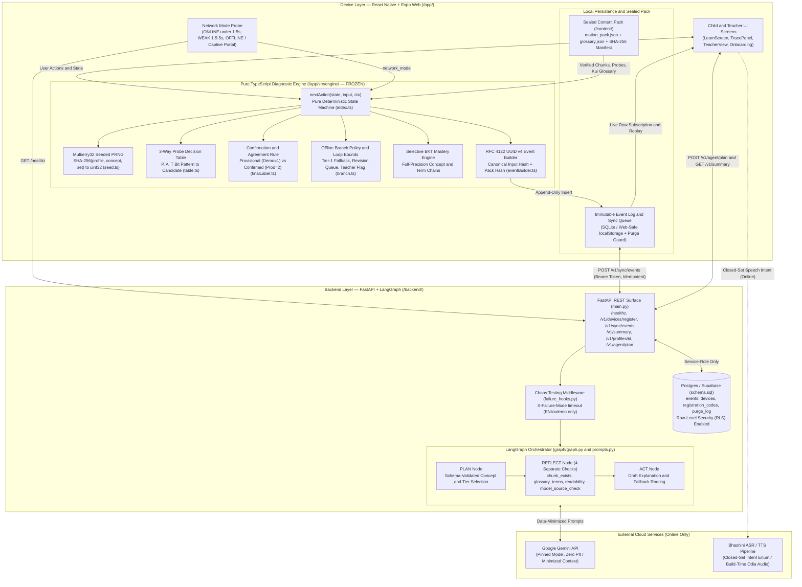
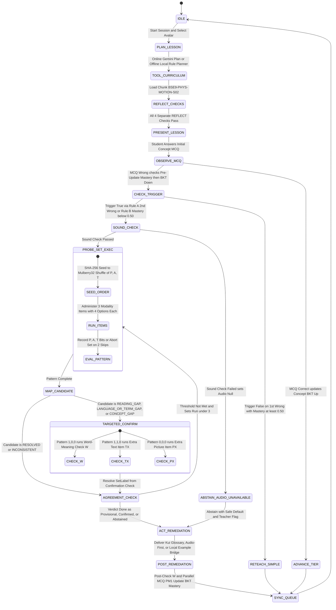
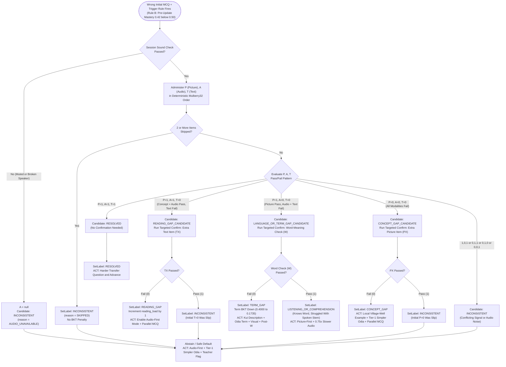
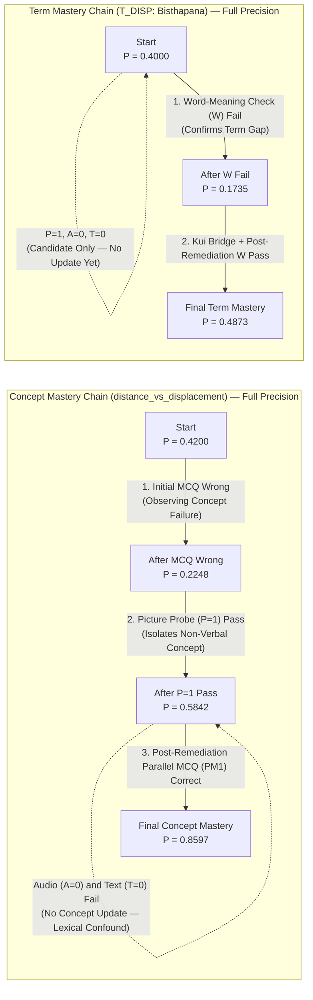
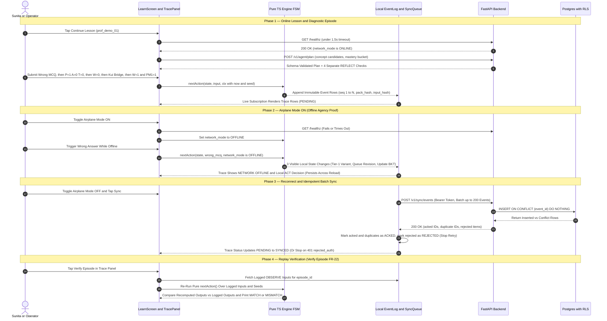
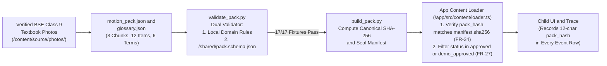

# Padhai Pocket — Offline-Resilient Diagnostic Agent for Class 9 Science in Odia & Kui

> **"One concept. One loop. Three causes. Offline agency."**
>
> **Event:** NEXTECH 2.0 · NIRMIT 2.0 (NMIET Bhubaneswar, Odisha · 14–15 October 2026)  
> **Problem Statement:** Agentic EdTech for Regional Language & Geography  
> **Team:** Coding_Aghoris — Sibam Prasad Sahoo (Backend & Engine), Satya Sarthak Manohari (Frontend & Sync), Pritam Piyush Nayak (AI & Content)  
> **Release State:** `main` (tagged `v1.0.0-finale`) · **Tests:** 98/98 Jest · 18/18 Pytest · 18/18 Content Validator (0 Placeholders)

Padhai Pocket is an offline-resilient diagnostic learning agent built for rural tribal Odisha students transitioning from mother-tongue primary schooling (Kui) into Odia-medium secondary science (Class 9 Physical Science: *Motion*). When a learner answers a science question incorrectly on a shared, low-connectivity device, Padhai Pocket does not guess or simply repeat the same explanation. Instead, its deterministic on-device engine runs a **3-way modality probe (Picture / Odia Audio / Odia Text)** plus a **targeted confirmation check** to screen whether the error stems from a **Concept Gap**, a **Reading Decoding Gap**, or an **Odia Scientific Term Gap**—and delivers the exact remedial bridge even when completely offline.

## 1. The Core Problem & Grounded Data Anchor

When **Sunita** (a Class 9 student in rural tribal Odisha who speaks **Kui** at home and studies science in **Odia** at school on a shared 4 GB phone with weak connectivity) misses a question on *Distance vs. Displacement*, standard EdTech apps treat every wrong answer identically. In reality, three distinct failure modes require three different pedagogical interventions:

| Failure Mode | What Actually Happened | Why Standard Re-Teaching Fails | Padhai Pocket Remediation (`ACT`) |
| :--- | :--- | :--- | :--- |
| **Concept Gap** | She does not yet grasp the physical difference between total path length and straight-line position change. | Repeating textbook definitions in formal Odia compounds confusion. | **Local Example + Tier-1 Simpler Odia:** Walks through a village-well path vs. straight-line example, then checks with a parallel MCQ. |
| **Reading Gap** | She understands the physics and spoken Odia, but cannot decode dense Odia script fast enough. | Showing another wall of Odia text penalizes reading fluency rather than science comprehension. | **Audio-First Mode (`audio_first = 1`):** Auto-plays spoken Odia with text highlighting, increments `reading_load`, and tests with a parallel MCQ. |
| **Term Gap** | She understands the physics and hears fine, but does not know the formal Odia scientific word (*Bisthapana* / ବିସ୍ଥାପନ). | Re-explaining the physics wastes time when only the lexical bridge is missing. | **Kui → Odia Lexical Bridge:** Everyday Kui explanation + Odia textbook term + visual diagram + post-remediation word-meaning check (`W`). |

### Why Class 9 in Odisha Is the Structural Inflection Point

* **Primary MLE Ends at Class V:** Odisha's Mother-Tongue-Based Multilingual Education (MLE) programme operates across ~1,500 schools in 17 tribal districts (~90,000 children, 101Reporters) and covers 24 tribal languages with primers in 21, including **Kui** (The Hindu 2017; NCERT journal review). However, MLE is a primary-grade programme (Classes I–V); by Class 9, Physical Science is taught entirely in Odia with no structured Kui-to-Odia bridge.
* **Reading & Device Reality (ASER 2024 Odisha):** In rural Odisha, **40%** of Standard III children could read a Standard II-level text. Among 14–16-year-olds, **83.2%** have smartphone access at home, while among those who can use a smartphone, **21.5%** own one (**17.3%** for girls)—making shared-device, no-login, low-footprint design mandatory.

## 2. End-to-End System Architecture

Padhai Pocket separates **online generative planning/reflection** from **offline deterministic diagnostic agency**. Every diagnostic decision, BKT mastery update, and remediation branch runs locally inside a pure TypeScript Finite State Machine (`/app/src/engine/`) with zero network, clock, or unseeded RNG dependencies.



### Architectural Layer Breakdown

| Layer | Technology | Directory | Responsibility & Constraints |
| :--- | :--- | :--- | :--- |
| **Frontend & Shell** | React Native + Expo (TypeScript), Web Export (`dist-FINAL/`) | `/app/` | Child-safe Odia UI (no "wrong", "gap", or English stack traces), live event-log Trace Panel, Episode Replay verifier, PIN-protected Teacher View, and Airplane Mode toggle. |
| **Diagnostic Engine** | Pure TypeScript FSM (Zero I/O, Zero Clock, Zero Math.random) | `/app/src/engine/` *(Frozen)* | Executes `nextAction(state, input, ctx)` with injected `now` and `seed`. Runs trigger rules, Mulberry32 probe ordering, candidate mapping, confirmation checks, agreement rules, and selective BKT updates. |
| **Content & Validator** | JSON Pack + Dual Python Validator + SHA-256 Sealer | `/content/` *(Frozen)* | Stores verbatim BSE Class 9 *Motion* chunks (`BSE9-PHYS-MOTION-S02`), 12 parallel probe/confirmation items, 6 Kui-bridged glossary terms, and verified textbook photos. |
| **Shared Contracts** | JSON Schema v1.1 + Golden Vectors | `/shared/` *(Frozen)* | Defines `event.schema.json`, `probe_vectors.json`, and `bkt_vectors.json` so TypeScript and Python implementations match within $5 \times 10^{-5}$. |
| **Backend & Agent** | FastAPI + LangGraph + PostgreSQL (RLS) | `/backend/` | Provides device registration, idempotent event batch sync, teacher summary aggregation, profile erasure with tombstone logging, chaos failure hooks, and the `PLAN → REFLECT → ACT` LangGraph workflow. |
| **Monte Carlo Simulator** | Python Synthetic Learner Simulator | `/eval/sim/` | Evaluates 20,000 synthetic learners per persona under assumed slip ($s=0.10$) and guess ($g=0.25$) noise to quantify correct-label vs. abstention rates. |

## 3. Core Workflows & Mermaid Diagrams

### 3.1 Full Diagnostic State Machine & Episode Lifecycle

Every learning interaction follows a strict, bounded state machine (`PLAN → TOOL → OBSERVE → PROBE → CONFIRM → REFLECT → ACT → MASTERY → FALLBACK → SYNC`). To prevent child fatigue and infinite loops, the engine enforces hard bounds (`≤ 3` sets per episode, `≤ 8` probe items per sitting in production, `≤ 2` remediation cycles per concept per session before `TEACHER_FLAG(LOOP_BOUND)`).



### 3.2 3-Way Probe Decision Table & Targeted Confirmation Logic

A 3-item pattern (`P`, `A`, `T`) **never** assigns a diagnostic gap label directly—a blind guesser produces `0,0,0` 42% of the time and `1,0,0` 14% of the time. Instead, every pattern maps to a **Candidate**, which must be verified by a **Targeted Confirmation Check** (`W`, `TX`, or `PX`) before becoming a `SetLabel`.



### 3.3 Selective Bayesian Knowledge Tracing (BKT) & Hero Storyline Chain

Padhai Pocket tracks **Concept Mastery** and **Term Mastery** independently using full-precision floating-point math (rounding to 4 decimal places for display and vector assertions only). Crucially, **each probe item updates only the latent state it was designed to isolate** (§5.3 Update Policy):

$$\text{Wrong: } P' = \frac{P \cdot s}{P \cdot s + (1 - P)(1 - g)} \qquad \text{Correct: } P' = \frac{P(1 - s)}{P(1 - s) + (1 - P) \cdot g} \qquad \text{Learn: } P_{\text{next}} = P' + (1 - P') \cdot t$$

* **Concept BKT Parameters:** $P_0 = 0.42$, slip $s = 0.10$, guess $g = 0.25$ (4-option item), transit/learn $t = 0.15$.
* **Term BKT Parameters (`T_DISP`):** $P_0 = 0.40$, slip $s = 0.10$, guess $g = 0.25$, transit/learn $t = 0.10$.



| Event in Episode | Concept Mastery Update | Term Mastery Update | Reading Load Counter | Rationale |
| :--- | :---: | :---: | :---: | :--- |
| **Initial MCQ Wrong** | **Down** (`0.4200 → 0.2248`) | No change | No change | Initial screening observation on target concept. |
| **Picture Probe Pass (`P=1`)** | **Up** (`0.2248 → 0.5842`) | No change | No change | Proves non-verbal conceptual understanding independent of Odia text/terms. |
| **Picture Probe Fail (`P=0`)** | **Down** | No change | No change | Direct evidence of non-verbal concept difficulty. |
| **Audio (`A`) or Text (`T`) Probe** | **No update** | **No update** | No change | Confounded by lexical knowledge and decoding; routed to confirmation first. |
| **Word Check (`W`) Fail (Pre-Bridge)** | No change | **Down** (`0.4000 → 0.1735`) | No change | Directly isolates unfamiliarity with the Odia scientific term. |
| **Word Check (`W`) Pass (Pre-Bridge)** | No change | **No update** | No change | Rules out term gap; routes to `LISTENING_OR_COMPREHENSION`. |
| **Word Check (`W`) Pass (Post-Bridge)** | No change | **Up** (`0.1735 → 0.4873`) | No change | Confirms lexical acquisition after Kui-to-Odia remediation. |
| **Second Text Item (`TX`) Fail (`A=1`)** | No change | No change | **`+1`** | Confirms reading decoding bottleneck despite intact audio comprehension. |
| **Parallel MCQ (`PM1`) Correct** | **Up** (`0.5842 → 0.8597`) | No change | No change | Verifies end-to-end conceptual transfer in Odia after remediation. |
| **Item Skipped (`SKIP`)** | **None** | **None** | **None** | Skips are zero evidence (never penalized as wrong; 2 skips abort set). |

### 3.4 Offline Continuity, Event Sync & Replay Verification Sequence

Padhai Pocket treats the local append-only `events` log as the single source of truth. `mastery` is a materialized view rebuildable to 4 decimals by replaying `events` (`FR-30`), and `sync_queue` manages delivery state (`PENDING` → `ACKED` or `REJECTED`) with exponential backoff and strict idempotency.



### 3.5 Content Pack Governance & Build-Time Sealing Pipeline

To guarantee that no unreviewed LLM hallucination ever reaches a child, Padhai Pocket enforces a build-time content governance pipeline (`FR-27`, `FR-34`).



## 4. Bounded Agent Autonomy: The Decision Register (`D1–D7`)

Why does a deterministic rule-based diagnostic engine count as a true **Agentic Architecture** (30% rubric weight)? Because an agent is defined by **autonomous perception, bounded decision-making over an action space, state mutation, and reflective verification**—not by putting an unreliable LLM inside an offline loop where it cannot run. Padhai Pocket's autonomy is governed by seven explicit decisions (`D1–D7`), each logged as an immutable event row:

| ID | Autonomous Decision | Observed Inputs | Action Space / Alternatives | Safety & Determinism Bound |
| :--- | :--- | :--- | :--- | :--- |
| **D1** | Which concept and difficulty tier to teach next | Profile BKT mastery, tier history, network state | 6 Motion chunks × 3 difficulty tiers | JSON schema-validated online (`planner=gemini`); falls back to `cached` or deterministic `rule` planner. |
| **D2** | Whether to fire a diagnostic probe episode | Pre-update concept mastery, session error count | `CONTINUE`, `RETEACH`, or `PROBE_START` | Fires on **Rule A** (2nd wrong in session) or **Rule B** (1st wrong when pre-update mastery `< 0.50`); max 1 active episode at a time. |
| **D3** | Which probe set and modality presentation order to administer | `(profile_id, concept_id, set_id)` | 6 permutations of `[P, A, T]` × 3 parallel sets (`A, B, C`) | Deterministic SHA-256 big-endian `uint32` seed → Mulberry32 Fisher-Yates shuffle. |
| **D4** | How to map `[P, A, T]` observations to a candidate or abstain | 3-bit modality vector + `sound_check` state | 4 candidates (`RESOLVED`, `READING_GAP`, `LANGUAGE_OR_TERM_GAP`, `CONCEPT_GAP`) or `INCONSISTENT` | Null audio (`A=null`) or mixed patterns (`1,0,1`, `0,1,1`, `0,1,0`, `0,0,1`) immediately abstain rather than guess. |
| **D5** | Which targeted remediation workflow to execute | Confirmed `SetLabel` / `FinalLabel` | Kui lexical bridge, Audio-first mode, Local example + Tier-1 Odia, Slow audio, or Safe default | Capped at `≤ 2` remediation cycles per concept per session. |
| **D6** | Which planning & explanation source to trust | `/healthz` latency, Gemini timeout, REFLECT checks | `gemini`, `cached_plan`, or `rule` | On timeout or failed REFLECT check, logs `FALLBACK: cached_plan` and serves pre-reviewed content. |
| **D7** | When to stop and escalate to the teacher | Abstention conflict, `AUDIO_UNAVAILABLE`, `SKIPPED`, `LOOP_BOUND`, `LISTENING_REPEAT` | `TEACHER_FLAG(reason)` or `CONTINUE` | Always logged and surfaced in the PIN-protected Teacher View. |

## 5. Deterministic Seed & Golden Vector Verification

Both the TypeScript engine (`/app/src/engine/`) and the Python reference mirror (`/eval/sim/`) implement the exact same seed derivation and PRNG specification:

1. **Seed String:** `"<profile_id>|<concept_id>|<set_id>"` (e.g., `"prof_demo_01|distance_vs_displacement|A"`).
2. **Hash to `uint32`:** First 4 bytes (big-endian) of `SHA-256(seed_string)`.
3. **Shuffle:** Mulberry32 PRNG driving a Fisher-Yates shuffle from index `2` down to `1` over `["P", "A", "T"]`.

| `profile_id` | `concept_id` | `set_id` | Computed `uint32` Seed | Deterministic Modality Order |
| :--- | :--- | :---: | :---: | :---: |
| `prof_demo_01` | `distance_vs_displacement` | `A` | `1806635391` | `["T", "A", "P"]` |
| `prof_demo_01` | `distance_vs_displacement` | `B` | `3861694576` | `["A", "T", "P"]` |
| `prof_demo_01` | `distance_vs_displacement` | `C` | `3787510126` | `["P", "A", "T"]` |
| `prof_demo_02` | `distance_vs_displacement` | `A` | `261969372` | `["T", "A", "P"]` |
| `prof_demo_02` | `distance_vs_displacement` | `B` | `3595333803` | `["P", "A", "T"]` |
| `prof_demo_02` | `distance_vs_displacement` | `C` | `1036361710` | `["T", "P", "A"]` |

## 6. Repository Structure & Frozen Boundaries

```text
Padhai-Pocket/
├── app/                          # React Native + Expo TypeScript Frontend
│   ├── src/
│   │   ├── engine/               # 🔒 FROZEN: Pure TypeScript Diagnostic FSM
│   │   │   ├── index.ts          # nextAction(state, input, ctx) state machine
│   │   │   ├── seed.ts           # SHA-256 -> uint32 + Mulberry32 Fisher-Yates
│   │   │   ├── table.ts          # P/A/T pattern -> Candidate & Confirmation resolver
│   │   │   ├── finalLabel.ts     # Provisional (threshold=1) & Confirmed (threshold=2) agreement
│   │   │   ├── branch.ts         # Offline policy & 3 visible state transitions
│   │   │   └── eventBuilder.ts   # RFC 4122 UUID v4 event row builder
│   │   ├── content/
│   │   │   └── loader.ts         # Real content pack loader (zero mocks)
│   │   ├── screens/
│   │   │   └── LearnScreen.tsx   # Main interactive learning, probe, remediation & trace UI
│   │   └── components/           # Trace panel, mastery cards, audio/picture probe views
│   └── dist-FINAL/               # Exported production web build (~993 KB bundle)
├── backend/                      # FastAPI + LangGraph Python Backend
│   ├── main.py                   # 6 REST endpoints (healthz, register, sync, summary, erase, plan)
│   ├── graph/
│   │   ├── graph.py              # LangGraph PLAN -> REFLECT -> ACT workflow
│   │   └── prompts.py            # Pinned Gemini prompts with data minimization
│   ├── failure_hooks.py          # Chaos testing middleware (X-Failure-Mode header)
│   └── schema.sql                # PostgreSQL schema + Row-Level Security (RLS)
├── content/                      # 🔒 FROZEN: Grounded Curriculum & Lexicon Pack
│   ├── motion_pack.json          # 3 BSE Class 9 Motion chunks, 12 items, 6 terms
│   ├── glossary.json             # Odia scientific terms + Kui descriptions
│   ├── tools/
│   │   ├── validate_pack.py      # Dual validator (local domain rules + JSON schema)
│   │   └── build_pack.py         # SHA-256 pack manifest sealer
│   └── source/photos/            # Verified BSE Class 9 Physical Science textbook photos
├── shared/                       # 🔒 FROZEN: Cross-Language Contracts & Golden Vectors
│   ├── event.schema.json         # v1.1 Event log JSON schema
│   ├── probe_vectors.json        # Golden test vectors for patterns, confirmations & verdicts
│   └── bkt_vectors.json          # Full-precision BKT mastery chain vectors
├── eval/
│   └── sim/                      # Monte Carlo synthetic learner reliability simulator (20k runs/row)
└── docs/
    ├── reference/Padhai_Final.pdf # Complete PRD & Build Bible (v4.0)
    ├── ledger.md                 # Claims Ledger (Verified, Measured, Simulated, Assumed)
    └── handoff.md                # Team interface contracts
```

## 7. Backend API Surface (`/backend/main.py`)

| Method & Path | Authentication | Request Payload | Response & Behavior |
| :--- | :--- | :--- | :--- |
| `GET /healthz` | None | — | Returns `{"ok": true}`. Used by the client network probe (`≤ 1.5s` = `ONLINE`, `1.5–5s` = `WEAK`, timeout = `OFFLINE`). |
| `POST /v1/devices/register` | Single-use 24h registration code | `{"device_id": "...", "registration_code": "..."}` | Issues a per-device bearer token once; stores only `token_hash` in `devices`. |
| `POST /v1/sync/events` | Device Bearer Token | `{"device_id": "d1", "events": [...]}` (`≤ 256 KB`, `≤ 200` events) | Validates against `event.schema.json`; inserts idempotently (`ON CONFLICT (event_id) DO NOTHING`); returns `{"acked": [...], "duplicates": [...], "rejected": [...]}`. |
| `GET /v1/summary` | Device Bearer Token | Query params (optional device/profile scope) | Returns aggregated concept mastery, term mastery, diagnostic label counts, abstentions, and teacher flags for the Teacher View. |
| `DELETE /v1/profiles/{id}` | Device Bearer Token | Path param `id` (`profile_id`) | Purges server-side profile events and records an audited tombstone in `purge_log` (`profile_hash`, `purged_at`, `event_count`). |
| `POST /v1/agent/plan` | Device Bearer Token / Demo | `{"candidate_concepts": [...], "mastery_bucket": "low/mid/high", "tier_history": [...]}` | Runs LangGraph `PLAN → REFLECT → ACT`. Honours `X-Failure-Mode: timeout` when `ENV=demo` to demonstrate deterministic fallback (`FALLBACK: cached_plan`). |

## 8. Quickstart & 10-Step Live Demo Runbook

### Prerequisites
* **Python 3.11+** (for FastAPI backend and static web server)
* **Node.js LTS** (optional, for running Jest tests or rebuilding `/app/`)

### Starting the Demo Servers

```bash
# Terminal 1 — Start the FastAPI + LangGraph Backend on port 8000
cd backend
python -m uvicorn main:app --host 127.0.0.1 --port 8000

# Terminal 2 — Serve the Production Web Bundle on port 3000
cd app/dist-FINAL
python -m http.server 3000
```

Open **`http://localhost:3000`** in Google Chrome.

### The 10-Step Stage Demo Flow

1. **Onboarding & Avatar Selection:** Click **Continue** through the teacher/guardian consent and pseudonymous avatar selection (`prof_demo_01`, initial concept mastery `0.4200`, initial term mastery `0.4000`).
2. **Start Grounded Lesson:** Click **Continue Lesson** to load BSE Class 9 Motion chunk `BSE9-PHYS-MOTION-S02` (*Distance vs. Displacement*) with all four `REFLECT` checks passing (`chunk_exists=PASS`, `glossary_terms=PASS`, `readability=PASS`, `model_source_check=PASS|UNAVAILABLE`).
3. **Trigger Diagnostic Episode:** Select a **wrong answer** on the initial Motion MCQ. Concept mastery updates `0.4200 → 0.2248`, and **Trigger Rule B** fires (`pre-update mastery 0.42 < 0.50`) after `sound_check=PASS`.
4. **Run the 3-Way Seeded Probe (`Set A`):** Complete the three modality probes in seeded order (`[T, A, P]`, seed `1806635391`): pass the Picture probe (`P=1`, Concept BKT rises `0.2248 → 0.5842`), fail the Audio probe (`A=0`), and fail the Text probe (`T=0`). The engine identifies `candidate = LANGUAGE_OR_TERM_GAP_CANDIDATE`.
5. **Targeted Confirmation & Remediation (`ACT`):** Fail the direct Word-Meaning Check (`W=0`, Term BKT drops `0.4000 → 0.1735`), confirming `label = TERM_GAP (provisional, CONFIRM_THRESHOLD=1, agreement=1/1)`. View the **Kui → Odia lexical bridge** (`T_DISP`), pass the post-remediation word check (`W=1`), and answer the parallel post-remediation MCQ (`PM1=1`) correctly.
6. **Verify Dual Mastery Panel:** Inspect the updated BKT estimates generated live by the engine: **Concept Mastery = `0.8597`** (`0.4200 → 0.2248 → 0.5842 → 0.8597`) and **Term Mastery = `0.4873`** (`0.4000 → 0.1735 → 0.4873`).
7. **Inspect Real-Time Trace Panel:** Open the **Trace** view to show every immutable event row (`PLAN`, `TOOL`, `REFLECT`, `OBSERVE`, `PROBE`, `CONFIRM`, `ACT`, `MASTERY`) with its `seq`, `input_hash`, and `pack_hash`.
8. **Prove Offline Agency (Airplane Mode ON):** Toggle **Airplane Mode ON** (`NETWORK: OFFLINE`). Trigger a wrong answer offline to demonstrate three local state transitions without network: selecting the Tier-1 simpler cached variant, queuing a revision, and updating BKT mastery locally (persisting across page reloads via `localStorage`).
9. **Reconnect & Idempotent Sync (Airplane Mode OFF):** Toggle **Airplane Mode OFF** and click **Sync**. Watch queued events transition from `PENDING` to `ACKED` (`dup 0`) via `POST /v1/sync/events`.
10. **Close:** *"One concept. One loop. Three causes. Offline agency."*

## 9. Verification & Test Suites

All three verification suites pass cleanly on `main`:

```bash
# 1. Frontend & Pure Engine Unit/Integration Suite (98/98 passing across 13 test suites)
cd app
npm test
npx tsc --noEmit

# 2. Backend API, Idempotency, Neural TTS & LangGraph Suite (18/18 pytest passing)
cd ../backend
pytest

# 3. Content Pack Dual Validator & Fixture Suite (18/18 tests passing, 0 placeholders)
cd ../content
python tools/validate_pack.py --pack motion_pack.json
```

## 10. Repository Architecture

Padhai Pocket follows a clean, modular structure:

* **`/app/`**: **Canonical Application** — React Native + Expo Web mobile-first client. Contains the frozen deterministic diagnostic engine (`/app/src/engine/`), interactive 3D simulations, SVG mastery charts, offline SQLite/localStorage event ledger, and audio player.
* **`/backend/`**: FastAPI REST server, LangGraph 4-gate reflection planner, dual-write Supabase edge mirror sync pipeline, and neural Odia TTS.
* **`/content/`**: BSE Class 9 Science content packs (`motion_pack.json`, `gravitation_pack.json`), Kui-to-Odia glossaries, audio manifests, and validator tools.
* **`/shared/`**: Immutable event schemas (`event.schema.json`), pack schemas (`pack.schema.json`), golden test vectors (`bkt_vectors.json`, `probe_vectors.json`), and OpenAPI v1.1.0 specifications.
* **`/eval/`**: Monte Carlo simulation engine (`simulator.py`), mirror evaluator, and test vectors verifying cross-language BKT parity ($\le 5 \times 10^{-5}$ float drift).
* **`/docs/`**: PRD v4.1, closed Claims Ledger (`ledger.md`), Evidence Handout (`evidence_sheet.md`), slide decks, and execution runbooks.
* **`/web-app-ui/`**: **Evaluator Desktop Companion** — Standalone desktop split-screen interface designed for hackathon stage screens (≥ 1024px displays the intact mobile child UI on the left and live diagnostic telemetry on the right). Runs the identical engine and contracts.

## 10. Reliability Budget & Claims Discipline

Padhai Pocket enforces strict scientific and engineering honesty. Under the PRD's Monte Carlo simulation (`20,000` synthetic learners per row at assumed slip $s=0.10$ and guess $g=0.25$):

* **Abstention Over Confident Mislabeling:** In production settings ($\ge 2$ sets, $2$ confirmation items), a true Term-Gap learner is correctly labeled **45%** of the time, abstains (`INCONSISTENT`) **42%** of the time, and receives another label only **13%** of the time. In shortened demo mode ($1$ set, $1$ confirmation item), correct-label rate is **37%** with **31%** abstention. The engine prefers saying *"I'm not sure"* (`INCONSISTENT` → safe default remediation + teacher flag) over guessing.

| What We Claim (Verified & Demonstrable Live) | What We Do NOT Claim (Explicitly Out of Scope) |
| :--- | :--- |
| **Offline diagnostic loop works end-to-end** (verified in Chrome with `localStorage` persistence). | **No on-device Odia LLM** or offline generative text synthesis (4 GB phone constraint). |
| **Grounded Odia content** extracted verbatim from BSE Class 9 Physical Science (*Motion*), sealed with SHA-256. | **No full Kui curriculum translation** or **Kui ASR / TTS** (starter text-only glossary bridging to Odia terms). |
| **Pure deterministic engine** (`nextAction`) where identical inputs and seeds always produce identical outputs. | **No diagnostic accuracy or psychometric calibration claims** (no ground-truth clinical dataset; BKT parameters are assumed). |
| **Auditable event log & idempotent sync** with server `acked`/`duplicates` confirmation and `401` retry stop. | **No student learning-gain claims** (`n=5` usability and pipeline-fidelity testing only) and **no Android APK claim** (web demo on stage). |
