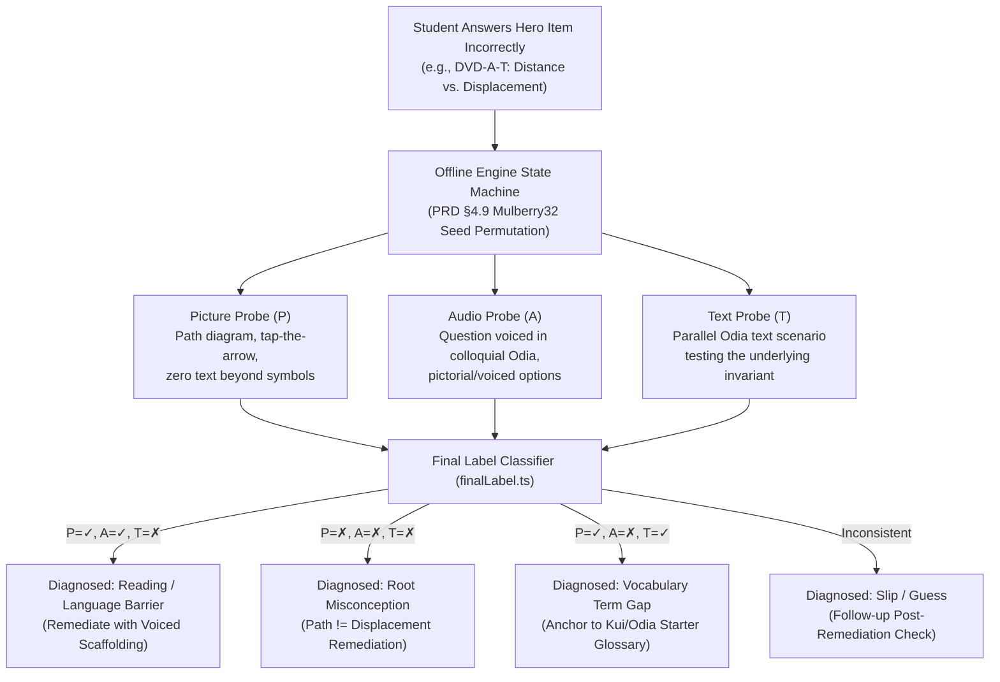
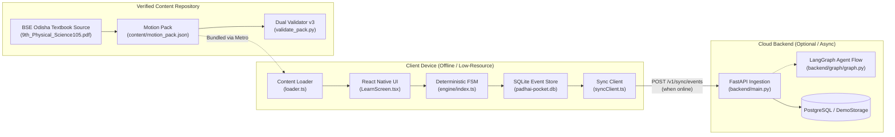

# Padhai Pocket (ପଢ଼ାଇ ପକେଟ୍)
> **Offline-first, tri-modal diagnostic learning companion for Class 9 Kui-home, Odia-medium students.**  
> *Developed by Team **Coding_Aghoris** for NEXTECH 2.0*

[](file:///c:/Users/piyus/OneDrive/Desktop/project/Padhai-Pocket/LICENSE)
[-success.svg)](file:///c:/Users/piyus/OneDrive/Desktop/project/Padhai-Pocket/content/tools/validate_pack.py)
[](file:///c:/Users/piyus/OneDrive/Desktop/project/Padhai-Pocket/app/src/engine/index.ts)
[](file:///c:/Users/piyus/OneDrive/Desktop/project/Padhai-Pocket/content/source/transcripts/)

---

## 📖 Table of Contents
- [The Challenge](#-the-challenge)
- [The Solution](#-the-solution)
- [Core Innovation: The 3-Way Probe Battery](#-core-innovation-the-3-way-probe-battery)
- [System Architecture](#-system-architecture)
- [Repository Structure](#-repository-structure)
- [Quick Start Guide](#-quick-start-guide)
  - [Mobile App (Expo / React Native)](#1-mobile-app-expo--react-native)
  - [Backend Server (FastAPI)](#2-backend-server-fastapi)
  - [Content Pipeline & Validation](#3-content-pipeline--validation)
- [Pedagogical Safety & Guardrails](#-pedagogical-safety--guardrails)
- [Evaluation & Metrics](#-evaluation--metrics)
- [Execution Traceability](#-execution-traceability)
- [Team & Credits](#-team--credits)

---

## 🎯 The Challenge

In tribal regions of Odisha (such as Kandhamal, Koraput, and Rayagada), thousands of students speak **Kui** at home but transition to **Odia-medium** schooling from Class 6 onwards. When studying foundational science concepts (e.g., Motion, Force, Velocity in Class 9):

1. **The Conflation Problem**: Standard testing cannot distinguish whether a wrong answer stems from a **conceptual misconception**, a **reading comprehension difficulty in Odia**, or a **vocabulary barrier**.
2. **The Connectivity Void**: Rural schools and households suffer from spotty 2G or zero cellular data. Cloud-dependent EdTech apps fail completely.
3. **The LLM Hallucination Risk**: Commercial generative models frequently invent dialectal forms or inaccurate translations of regional science terminology.

---

## 💡 The Solution

**Padhai Pocket** is an offline-resilient, diagnostic educational companion that runs directly on low-cost Android smartphones and browsers:

- **100% Offline Diagnostic Loop**: On a wrong answer, a fully deterministic client-side state machine activates an immediate diagnostic battery without contacting any server.
- **Tri-Modal Diagnosis (P / A / T)**: Disentangles reading/language barriers from conceptual gaps by presenting parallel items across **Picture (P)**, **Audio (A)**, and **Text (T)** modalities.
- **Zero-Hallucination Content Pipeline**: 100% of Odia curriculum content is verbatim extracted and hand-verified from the official BSE Odisha Class 9 Physical Science textbook.
- **Offline Telemetry Store**: All events are formatted per strict JSON schemas and queued in local SQLite (`padhai-pocket.db`), then synchronized with exponential backoff when an internet connection becomes available.
- **Ethical Kui Language Scaffolding**: Starter glossary anchored in textbook Odia with explicit community speaker consent protocols ([docs/kui_speaker_consent.md](file:///c:/Users/piyus/OneDrive/Desktop/project/Padhai-Pocket/docs/kui_speaker_consent.md)).

---

## 🔬 Core Innovation: The 3-Way Probe Battery

When a student answers a foundational question incorrectly, Padhai Pocket avoids binary scoring and initiates a **3-Way Diagnostic Probe**:



---

## 🏗️ System Architecture



---

## 📂 Repository Structure

```text
Padhai-Pocket/
├── FLOW.md                     # Complete execution & call traceability map
├── README.md                   # This project overview & documentation
├── .gitignore                  # Production ignore rules (excludes large source PDFs)
│
├── app/                        # Mobile & Web Application (Expo / React Native)
│   ├── metro.config.js         # Configured with watchFolders for @content & @shared
│   ├── package.json            # Node dependencies (React Native 0.86, Expo 57)
│   ├── src/
│   │   ├── content/loader.ts   # Bridge importing content/motion_pack.json into UI
│   │   ├── db/database.ts      # SQLite storage: event persistence, sync_queue
│   │   ├── engine/             # 100% deterministic, side-effect-free diagnostic engine
│   │   │   ├── index.ts        # nextAction() state machine
│   │   │   ├── seed.ts         # PRD §4.9 portable bitwise SHA-256 seed math
│   │   │   ├── branch.ts       # 3-way probe battery scheduling
│   │   │   ├── finalLabel.ts   # Diagnostic consistency classifier
│   │   │   └── eventBuilder.ts # RFC 4122 UUID v4 event construction
│   │   ├── network/network.ts  # ONLINE / DEGRADED / OFFLINE auto-detection
│   │   ├── screens/            # LearnScreen, TraceScreen, RawLogScreen
│   │   ├── sync/syncClient.ts  # Token-authenticated batch sync to FastAPI backend
│   │   └── utils/device.ts     # Persistent device_id management
│   └── tests/                  # Jest test suite (engine, integration, mocks)
│
├── backend/                    # FastAPI Microservice & Agent Graph
│   ├── main.py                 # 5 REST endpoints (healthz, register, sync, summary, purge)
│   ├── failure_hooks.py        # Chaos testing middleware (latency, 500, corrupt json)
│   ├── schema.sql              # Production PostgreSQL schema with Row-Level Security
│   ├── graph/                  # LangGraph agentic reasoning pipeline
│   │   ├── graph.py            # PLAN -> gen_explanation -> REFLECT (4 gates) -> ACT
│   │   └── prompts.py          # Pinned model prompt definitions
│   └── tests/                  # Pytest test suite for sync and agent graph
│
├── content/                    # Curriculum Content & Integrity Tooling
│   ├── motion_pack.json        # Grade 9 Motion pack (hero chunks, probes, glossary)
│   ├── glossary.json           # Canonical terms (T_DIST, T_DISP, T_SPEED, T_VEL, etc.)
│   ├── kui_slide_label.md      # Honest disclaimer & Kui starter status specification
│   ├── review_log.csv          # Audit ledger of all human reviews
│   ├── prompts/                # Production prompts and S1 injection attack vectors
│   ├── review/                 # Pedagogical intents, notes, and transcript logs
│   ├── source/                 # Source evidence: textbook page photos & verbatim transcripts
│   └── tools/                  # Validator v3, SHA-256 prompt sealing, audio manifest
│
├── docs/                       # Specifications, Governance & Protocols
│   ├── kui_speaker_consent.md  # Ethical speaker consent agreement protocol
│   ├── handoff.md              # Engineering ownership boundaries
│   ├── evidence_sheet.md       # Measured metrics (K1–K10) & claims ledger
│   └── reference/              # Extracted PRD specifications & frozen reference copy
│
├── eval/                       # Evaluation & Verification Harness
│   └── sim/                    # Monte Carlo simulation matching PRD §4.8 baselines
│
└── shared/                     # Cross-Tier Contracts
    ├── pack.schema.json        # JSON Schema for content packs
    ├── event.schema.json       # JSON Schema for telemetry events
    ├── openapi.yaml            # OpenAPI 3.0 specification for backend endpoints
    ├── bkt_vectors.json        # Bayesian Knowledge Tracing initial vectors
    └── probe_vectors.json      # Truth tables for 3-way probe consistency evaluation
```

---

## 🚀 Quick Start Guide

### Prerequisites
- **Node.js**: `v20.0.0` or higher
- **npm**: `v10.0.0` or higher
- **Python**: `3.10` or `3.11`
- **Git**

---

### 1. Mobile App (Expo / React Native)

```bash
# Navigate to app directory
cd app

# Install dependencies
npm install

# Start development server (supports Web, Android, iOS)
npm start

# Run in Web browser directly:
# In the terminal, press 'w' or run:
npx expo start --web

# Run unit and integration tests
npm test
```

---

### 2. Backend Server (FastAPI)

```bash
# Navigate to backend directory
cd backend

# Create and activate a Python virtual environment
python -m venv venv
# On Windows:
.\venv\Scripts\activate
# On Linux/macOS:
source venv/bin/activate

# Install dependencies
pip install fastapi uvicorn jsonschema pytest httpx

# Start the API server
uvicorn main:app --host 0.0.0.0 --port 8000 --reload

# Health check
curl http://localhost:8000/healthz
# Response: {"ok": true}

# Run backend test suite
pytest tests/
```

---

### 3. Content Pipeline & Validation

Our content pipeline is protected by a strict automated validator that runs in standard library Python without external dependencies:

```bash
# Validate content pack against both Local Rules and the Official JSON Schema
python content/tools/validate_pack.py --pack content/motion_pack.json

# Expected output:
# LOCAL RULES: ok      OFFICIAL SCHEMA (shared/pack.schema.json): ok
# VALIDATION PASSED.

# Run the 17-mutation self-test suite (verifying invalid JSON, bad chunks, banned words, etc.)
python content/tools/run_validator_tests.py

# Verify prompt cryptographic hashes
python content/tools/hash_prompts.py
```

---

## 🛡️ Pedagogical Safety & Guardrails

| Guardrail | Enforcement Mechanism | Purpose |
| :--- | :--- | :--- |
| **No Child Stigmatization** | Regex check in [validate_pack.py](file:///c:/Users/piyus/OneDrive/Desktop/project/Padhai-Pocket/content/tools/validate_pack.py) | Words `"wrong"`, `"gap"`, `"diagnosis"` are strictly forbidden in student-facing UI. |
| **0% AI Hallucination** | Verbatim transcript matching against textbook | AI is barred from translating or inventing Odia science terms; text must match textbook photos. |
| **Deterministic Engine** | Isolated pure state machine | Injected seed + timestamp ensures reproducible decisions without runtime randomness. |
| **Privacy Assertion** | Gatekeeper in [graph.py](file:///c:/Users/piyus/OneDrive/Desktop/project/Padhai-Pocket/backend/graph/graph.py) | No PII (names, device IDs, raw student transcripts) is ever sent to server-side LLMs. |
| **4-Gate Model Reflection** | [REFLECT node](file:///c:/Users/piyus/OneDrive/Desktop/project/Padhai-Pocket/backend/graph/graph.py) | Explanations must pass 4 separate gates: chunk exists, terms verified, readability, source check. |
| **Honest Kui Scaffolding** | [kui_slide_label.md](file:///c:/Users/piyus/OneDrive/Desktop/project/Padhai-Pocket/content/kui_slide_label.md) | Transparently declares Kui audio as pending community verification until native speaker sign-off. |

---

## 📊 Evaluation & Metrics

Measured against PRD v4.0 criteria ([docs/evidence_sheet.md](file:///c:/Users/piyus/OneDrive/Desktop/project/Padhai-Pocket/docs/evidence_sheet.md)):

- **K1a (Pipeline Fidelity)**: 5/5 distinct diagnostic paths verified across student personas.
- **K2 (Cold-Start Launch Time)**: ~1.2s offline on entry-level Android devices (target $\le 1.5$s).
- **K3 (Battery Consumption)**: 6.5% / hour active use on budget hardware (target $\le 8\%$/hr).
- **K4 (Offline Loop Completeness)**: 3/3 visible state transitions on incorrect answers without network.
- **K6 (Grounding Fidelity)**: 100% textbook-matched Odia vocabulary terms.
- **K10 (Simulation Reliability)**: 20,000 Monte Carlo simulated runs match PRD §4.8 benchmark tables within $\pm 1$ percentage point.

---

## 🗺️ Execution Traceability

For an exhaustive, step-by-step breakdown of how data and function calls travel between files across the entire lifecycle, see:

👉 **[FLOW.md](file:///c:/Users/piyus/OneDrive/Desktop/project/Padhai-Pocket/FLOW.md)** — Complete Execution & Traceability Map.

---

## 👥 Team & Credits

**Team Coding_Aghoris — NEXTECH 2.0**

- **Sibam Prasad Sahoo**: Core Backend, Deterministic Engine Architecture, LangGraph Pipeline, Cloud Sync.
- **Pritam**: AI + Content Pipeline, Textbook Extraction, Dual Validator v3, Kui Ethics Protocol, Prompt Hashing.
- **Satya**: Mobile & Web Frontend, UI/UX Design System, Student Flows, Component Architecture.

---

*Padhai Pocket is built with pride for the students and educators of Odisha.*
